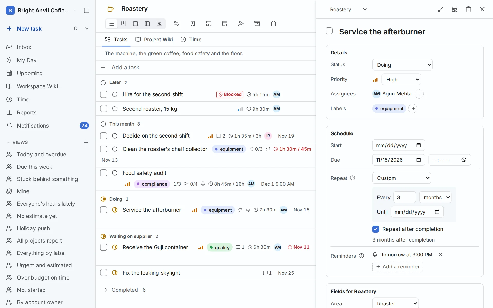
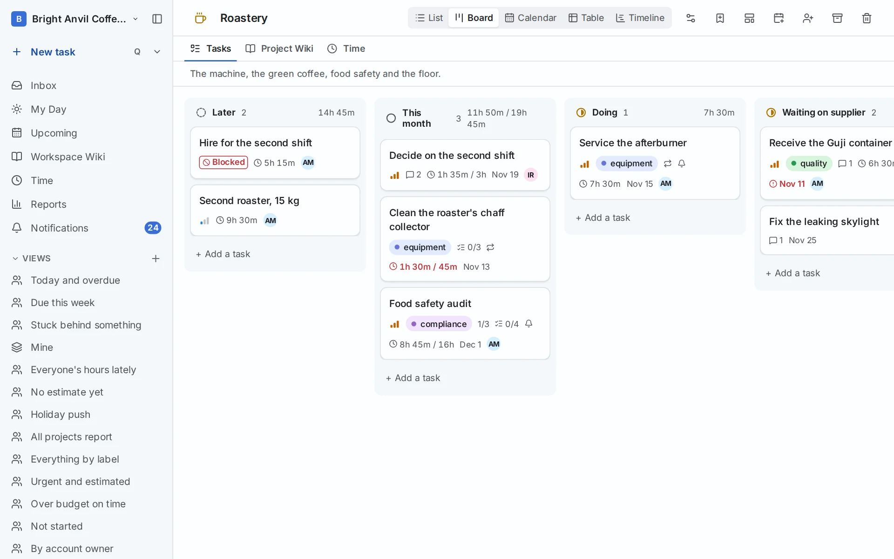
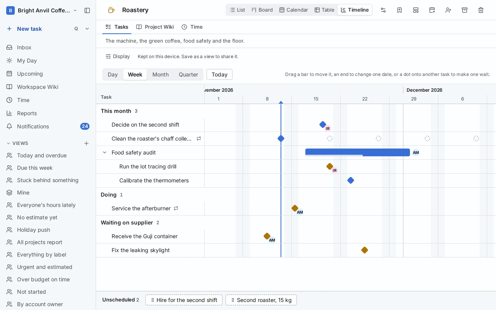
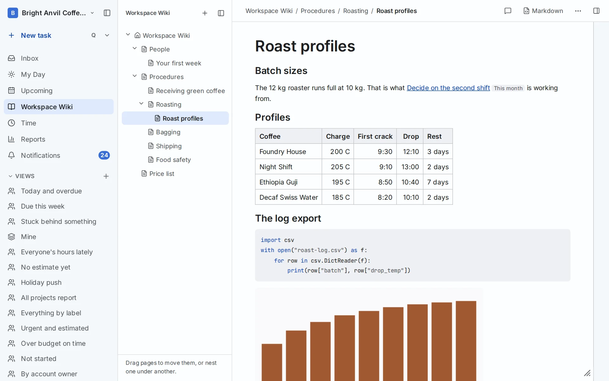
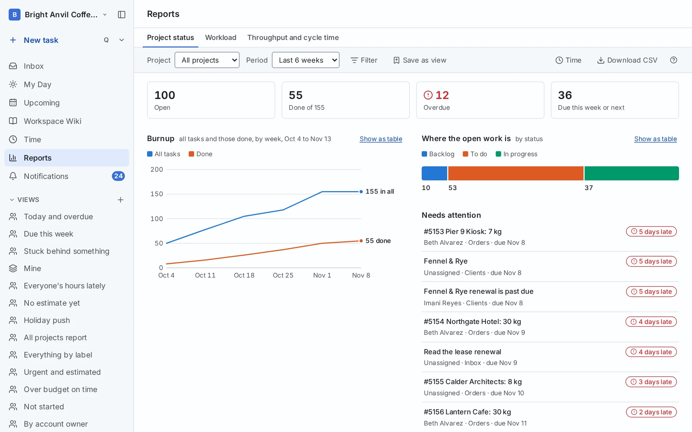
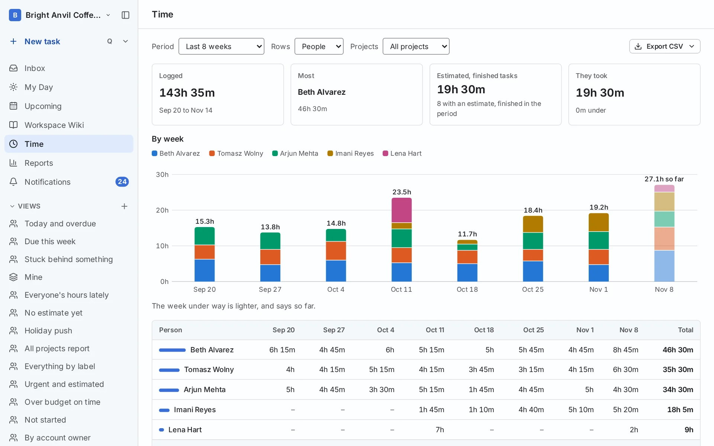
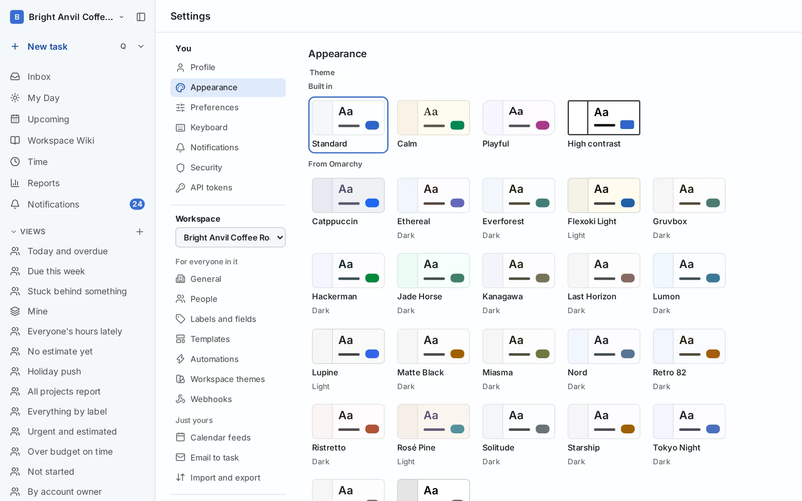

<p align="center">
  
</p>

<h1 align="center">Mila</h1>

<p align="center">
  <strong>Your tasks, notes and time in one calm, fast place that you own.</strong><br>
  For you, your household or your small team. Works offline. Runs anywhere from a single file.
</p>

<p align="center">
  <a href="https://github.com/locodarwin/mila/releases/latest"></a>
  <a href="https://github.com/locodarwin/mila/actions/workflows/ci.yml"></a>
  <a href="LICENSE"></a>
</p>

<p align="center">
  <a href="#get-started">Get started</a> ·
  <a href="docs/guide/README.md">User guide</a> ·
  <a href="docs/self-hosting.md">Running Mila</a> ·
  <a href="docs/guide/desktop-app.md">Desktop app</a> ·
  <a href="docs/agents.md">API and agents</a>
</p>

<picture>
  <source media="(prefers-color-scheme: dark)" srcset="docs/guide/images/app-dark.webp">
  
</picture>

Mila is a home for everything you need to get done. Plan a kitchen remodel with your family, run client work as a freelancer, or keep a small team's projects, notes and hours together. Your tasks, your notes and your time live side by side, and they stay with you: on your own computer, or on any server you choose.

## Why Mila

- **It's yours.** No subscription, no fee for each person you add, and no company holding your work. Mila runs on your own computer, a server at home (even a Raspberry Pi or other small device!), a NAS, or a small rented server.
- **It keeps working when the internet doesn't.** Every device keeps its own copy of your work, so changes appear the moment you make them. When back online, Mila catches up and everyone sees the same thing.
- **Tasks, notes and time in one place.** Projects and tasks, a wiki for everything that isn't a task, and time tracking with reports, all linked to each other.
- **Quick to use.** Type a whole task in one line, like `Call Dana tomorrow 3pm #work !high`, and Mila fills in the date, project and priority. Everything has a keyboard shortcut you can change, and it works just as well on your phone.
- **Bring what you already have.** Move your work over from Asana, Todoist, ClickUp, monday.com, Notion, Confluence, GitHub Issues or any spreadsheet, with a preview before anything is made. More import formats are planned.
- **Made for everyone.** Mila works fully from the keyboard and with a screen reader, with large text sizes, a high-contrast theme, and 26 looks to choose from. The built-in theme editor is about as comprehensive as a theme editor can be while still being easy to use.

## Who it's for

| | |
|---|---|
| **Just you** | Personal to-dos, errands and plans. My Day holds what you picked for today, tasks repeat on their own, and reminders reach your phone. With the desktop app you don't even need a server or an account. |
| **A household** | A shared board for the remodel, chores that repeat, the grocery run assigned, and a wiki page with the Wi-Fi password and the warranty dates. |
| **Freelancers** | A project for each client, shared with that client (if you wish) as a guest who sees nothing else. A timer on each task, hours by client or by week, and a timesheet to export for invoicing. |
| **Small teams** | Each project with its own stages, assignments, comments with @mentions, and a team wiki several people can write in at once. Reports on progress and workload, a weekly summary by email, and rules that do the routine work. |
| **Tinkerers and your agents** | A documented API, webhooks, calendar feeds and email-to-task. AI assistants can work in Mila too, through MCP, as teammates with tasks of their own. |

## A look around

<table>
  <tr>
    <td width="50%">
      <picture>
        <source media="(prefers-color-scheme: dark)" srcset="docs/guide/images/board-dark.webp">
        
      </picture>
      <p><strong>Boards, lists, tables, calendars and timelines.</strong> Every project, and your Inbox, My Day and Upcoming, can be shown any of these ways.</p>
    </td>
    <td width="50%">
      <picture>
        <source media="(prefers-color-scheme: dark)" srcset="docs/guide/images/timeline-dark.webp">
        
      </picture>
      <p><strong>Plan over time.</strong> Drag bars to reschedule, and mark which tasks wait for others.</p>
    </td>
  </tr>
  <tr>
    <td width="50%">
      <picture>
        <source media="(prefers-color-scheme: dark)" srcset="docs/guide/images/wiki-dark.webp">
        
      </picture>
      <p><strong>A wiki for everything else.</strong> Pages inside pages, history, comments pinned to the words they're about, and live views inside a page.</p>
    </td>
    <td width="50%">
      <picture>
        <source media="(prefers-color-scheme: dark)" srcset="docs/guide/images/reports-dark.webp">
        
      </picture>
      <p><strong>Reports.</strong> Progress, workload, and how long work takes from start to done, counting only what you can see.</p>
    </td>
  </tr>
  <tr>
    <td width="50%">
      <picture>
        <source media="(prefers-color-scheme: dark)" srcset="docs/guide/images/time-dark.webp">
        
      </picture>
      <p><strong>Time tracking.</strong> A timer or typed-in time, on tasks or projects, added up by person, project or week.</p>
    </td>
    <td width="50%">
      <picture>
        <source media="(prefers-color-scheme: dark)" srcset="docs/guide/images/themes-dark.webp">
        
      </picture>
      <p><strong>Make it yours.</strong> Four built-in themes, 22 more, and a comprehensive theme editor that checks every color for contrast.</p>
    </td>
  </tr>
</table>

## What it does

**Tasks and projects.** Subtasks, checklists, start and due dates, repeats, reminders, priority, labels, people, your own fields, files and comments. Saved views keep a filter and a layout under a name. Select many tasks to change them at once, start from templates, and undo nearly anything.

**A wiki.** One for the workspace and one for each project, written in an editor that several people can use at once: headings, tables, columns, foldable sections, pictures, and links between pages and tasks.

**Time and reports.** Estimates, timers and a Time page that exports a spreadsheet. Reports on project progress, workload and cycle time, worked out on your device so they work offline.

**Staying in the loop.** Notifications in the app, by email and as pushes to your phone and desktop, a daily digest, a weekly report, and calendar feeds for Google Calendar, Outlook or Apple Calendar.

**Working together.** Workspaces with owners, admins, members and guests. Sign in with a passkey or an emailed link: no passwords, and nobody gets in without an invitation.

**Your data, your way.** Export a whole workspace whenever you like, as a file Mila can import again, as spreadsheets or as Markdown. Nightly backups, with a one-command restore.

## Get started

### Try it for five minutes

With Docker installed (Docker Desktop on Windows or a Mac):

```sh
docker run --rm -p 127.0.0.1:8080:8080 ghcr.io/locodarwin/mila:latest
```

Open the setup link it prints, and look around at http://localhost:8080. Nothing is kept when it stops.

### Use it on your own computer

Just you, with no server and no account. Get the desktop app from the [latest release](https://github.com/locodarwin/mila/releases/latest):

- **Windows:** `Mila_<version>_x64-setup.exe`, or the portable zip. The installer isn't signed yet, so Windows may say "Windows protected your PC": choose More info, then Run anyway.
- **Linux:** `Mila_<version>_amd64.AppImage`. Allow it to run as a program, then open it.

Open Mila and choose **Keep it on this computer**.

There's no Mac app yet. On a Mac, you can run the Mila server itself and use it in your browser; [the release notes](https://github.com/locodarwin/mila/releases/latest) have the steps. It hasn't been tried on a Mac, so please tell us how it goes.

### Share it with your family or team

In this case, Mila needs a machine that's always on, so everyone's devices can reach it anytime. [Running Mila](docs/self-hosting.md) walks through each of these:

| You have | How |
|---|---|
| A NAS (Synology, UGREEN, TrueNAS, Unraid) | Install it from the NAS's Docker or container app. [Steps for each](docs/self-hosting.md#option-4-a-nas) |
| A Raspberry Pi or a spare Linux computer | One script installs and starts it. [The install script](docs/self-hosting.md#with-the-install-script) |
| A small rented server (a VPS) | Three files and `docker compose up -d`; HTTPS comes by itself. [A machine of its own](docs/self-hosting.md#option-1-a-machine-of-its-own) |
| A server that already runs a proxy | [Behind a proxy you already run](docs/self-hosting.md#option-2-behind-a-proxy-you-already-run) |

You'll want a web address of its own, such as `mila.example.com` (passkeys and phones need one, with HTTPS), and, if you can, an email service for invitations and reminders.

Once it's running, open the setup link Mila prints to make your account, press `q` to add tasks, and invite people from Settings, People. On your phone, open your Mila address and add it to the Home Screen: it opens like an app and works offline.

## Documentation

- **[The user guide](docs/guide/README.md):** everything Mila does, with pictures. Mila's own Help, at the foot of the sidebar, has the same and more.
- **[Running Mila](docs/self-hosting.md):** installing, email, backups, upgrades and every setting.
- **[Agents and the API](docs/agents.md):** scripts, AI assistants and MCP. Every Mila server shows its API reference at `/api/docs`.

## Security

No passwords, invitation-only accounts, one permission check behind every request, a strict Content Security Policy, and release files you can verify. Mila went through four rounds of security review before its first public release. To report a problem privately, see [SECURITY.md](SECURITY.md).

## Under the hood

Mila is one program written in Go, with its app (Svelte 5) built in. It keeps its data in SQLite, a single file, or in Postgres, and moves between them with one command. Each device keeps a copy of its workspaces and syncs edits as they happen, merging them so every device ends up the same; pages are edited together live with Yjs. The desktop app is built with Tauri. Idle, the server uses about 50 MB of memory, and its speed is held to performance budgets in its tests.

## Contributing

Bug reports and ideas are welcome in [Issues](https://github.com/locodarwin/mila/issues). To build Mila, run its tests or send a change, see [CONTRIBUTING.md](CONTRIBUTING.md).

## License

Mila is free software under the MIT license: see [LICENSE](LICENSE).
