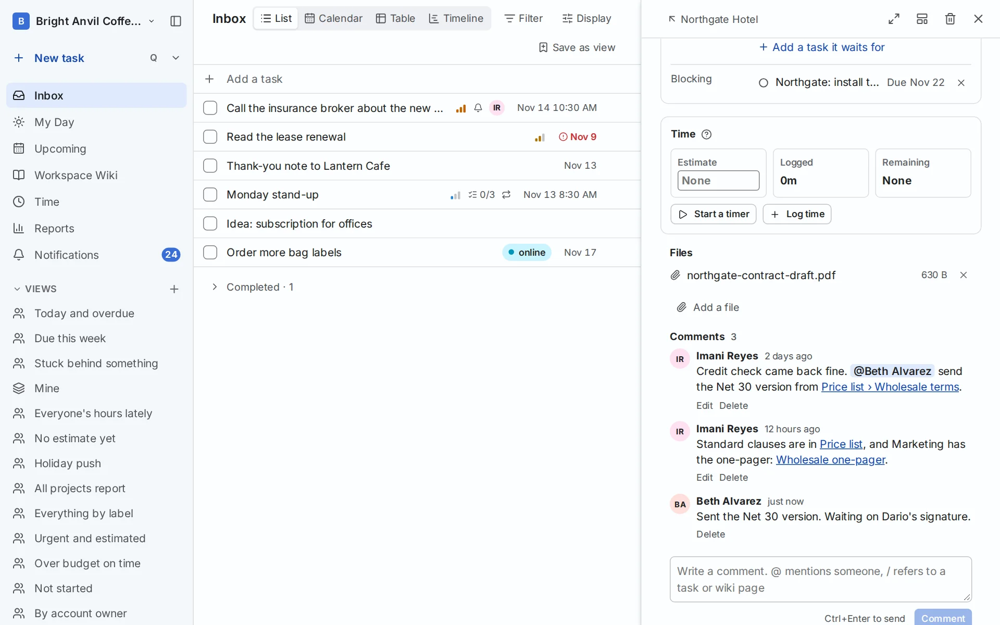

# Comments

Comments are at the end of a task's panel. Type in the box and choose Comment, or press `Ctrl+Enter`.



Comment text is plain. You can mention people, refer to tasks and pages, and paste web addresses, but Markdown formatting does not apply here. [Notes](writing.md) are the place for formatted text.

Below your own comments are Edit and Delete. Owners and admins also have Delete on other people's comments, with Undo on the toast it shows. An edited comment says so.

Right-click a comment for Copy text and Copy link to the task, with Edit and Delete where you have them. See [Right-click menus](menus.md).

Wiki pages have comments too, pinned to the words they are about. See [Comments on wiki pages](#comments-on-wiki-pages).

## Mentioning someone

Type `@` and choose from the list, which narrows as you type. Use the arrow keys, then `Enter` or `Tab` to pick. A long list scrolls, keeping your choice in view. `Escape` closes the list.

The list shows who can reach this task: the workspace's members, and any guests the project is shared with. For a task in the Inbox, that means members only. You are not in the list. A guest the project is not shared with does not appear.

The person you pick gets a [notification](notifications.md) that links to the task. Adding a new mention when you edit a comment tells that person too. People already mentioned are not told again.

## Referring to a task or page

Type `/task` or `/wiki` at the start of a line or after a space, then a space and part of a title. Pick from the list.

```
/task prep the walls
/wiki paint colors
```

While you type, a reference shows in double brackets, such as `[[Prep the walls]]`. Once sent, it is a link.

If a wiki page has headings, Mila then asks for a section, or The whole page. A link to a section goes straight there.

A reference follows its target: rename the task or page, and the comment shows the new title.

Someone who cannot open what you referred to sees "a task" or "a page" in its place, and never the title. A guest reading your comment sees it that way for anything outside the projects shared with them.

To link a page from notes or another page, use `[[` instead. See [Links to pages and tasks](writing.md#links-to-pages-and-tasks).

## Web addresses

An address starting with `http://` or `https://` becomes a link when the comment shows. Nothing else in a comment becomes a link.

## Comments on wiki pages

In a wiki page, select some words and choose Comment in the formatting bar, or press `Ctrl+Alt+M`. The comment goes in the Comments tab beside the page, and the words are highlighted. Anyone who can read the page can comment, guests included.

Page comments work like a task's: mentions, `/task`, `/wiki` and web addresses all do the same. Each thread can also take replies, and is resolved when it is settled. See [Comments on a page](wiki.md#comments-on-a-page).

## Who hears about a comment

The person who made the task and the people assigned to it get a Comments notification, along with anyone mentioned. You are never told about your own comment. People choose where these go in [Settings, Notifications](notifications.md).

On a wiki page, the people you mention get a Mentions notification, and everyone already in the thread gets one under Comments on pages.

## Next

- [Dependencies](dependencies.md)
- [Notifications](notifications.md)
