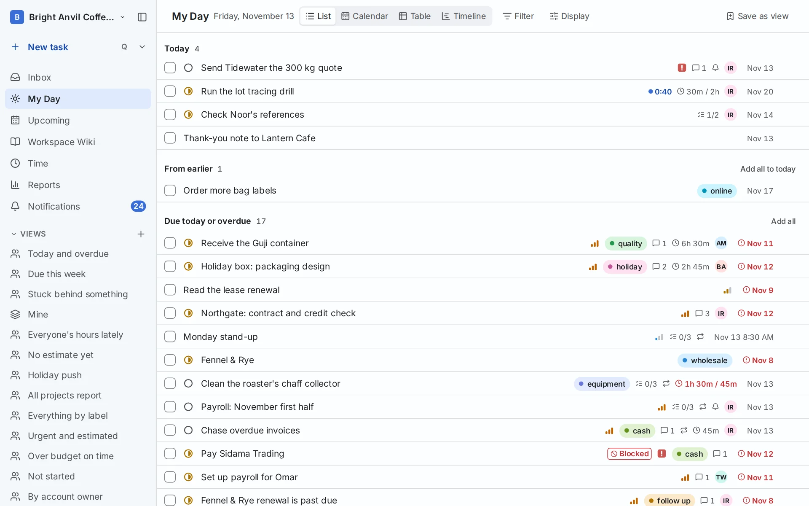
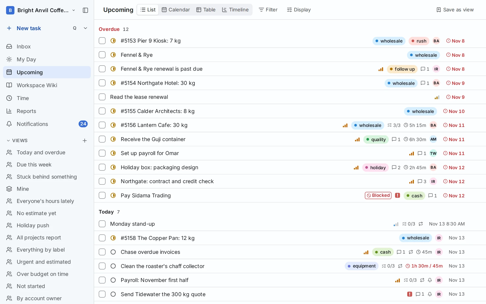

# Inbox, My Day and Upcoming

These three lists sit at the top of the sidebar. The Inbox holds what has not been sorted yet, My Day what you will do today, and Upcoming what is coming.

There is no separate Today page. Your plan for today is My Day, and its first section is called Today.

## Inbox

Press `g` then `i`.

The Inbox holds the workspace's tasks with no project. Use it to catch something now and sort it later: anything added with [quick add](quick-add.md) and no project lands here. To give a task a project, open it and change the project at the top of its panel, use Move the task to a project in the [command palette](search-and-palette.md), or right-click it and choose Move to. To move several, [select them](selecting-tasks.md) and choose Move to in the bar.

Each workspace has one Inbox. In a shared workspace, every member and owner sees the same tasks in it, and the empty page says so. For work only you should see, use your Personal workspace. Guests have no Inbox and no link to it: their work is in the projects shared with them.

Guests cannot see the Inbox's tasks or add to it.

## My Day

Press `g` then `d`.

My Day is your list for today. It is yours alone: nobody else in the workspace sees what you picked, and picking a task changes nothing about the task itself.

To add a task:

- On a task in a list, press `t`. The same key takes it out again.
- Choose Add to My Day in the task's schedule chooser: its date button, or a swipe to the left on a phone.
- Open the [command palette](search-and-palette.md) with a task focused or open, and choose Add the task to My Day.
- Right-click a task and choose Add to My Day.
- Use quick add while you are on My Day.

The page has three sections.

Today holds what you picked for today.

From earlier holds tasks you picked on an earlier day and have not finished. They are not moved to today on their own, so each morning starts with a choice. Add all to today brings them all back, or add them one at a time.

Due today or overdue suggests the open tasks in the workspace that are due today or earlier and not picked yet, whoever they are assigned to. Add all puts them all in today's list.

A "my tasks" [calendar feed](calendar-feeds.md) includes My Day as well as what is assigned to you.

## Upcoming

Press `g` then `u`.

Upcoming shows every open task with a due date, across all the projects you can see: what is overdue, then today and each of the next six days, then everything later. Tasks on the same day are in order of their due time.

Upcoming is not limited to tasks assigned to you. For only your own work, choose Me under Assignee in Upcoming's Filter, or make a [saved view](saved-views.md): a new one starts out showing the tasks assigned to you.

## Other ways to see them

Inbox, My Day and Upcoming can each show as a list, a board, a calendar, a table or a timeline. Choose with the List, Board, Calendar, Table and Timeline buttons at the top of the page. See [Layouts](layouts.md).

A board here has a column for each priority, since each project has statuses of its own. Upcoming's starts with its own days instead: Overdue, Today, Tomorrow, the next five days by name, and Later. In My Day and Upcoming each card shows its project. In Display, Columns can be Priority, Due date, or a select or person field every project shares. Moving a card to another column gives its task that priority, day or choice; moving one to Later makes it due the day after the week. Nothing moves into Overdue. In My Day and Upcoming, cards stay in the list's own order, since they come from many projects; open a project to move one up or down.

Filter and Display, beside those buttons, work as they do in a [saved view](saved-views.md#sort-group-and-show). A calendar has no Display.

A filter narrows what the list holds and never adds to it. The Inbox still shows only tasks with no project, so its filter has no Project part. My Day still shows only your picks, so its filter has no In my My Day. Upcoming still shows only open tasks with a due date. See [Filters](filters.md).

In a list, each keeps its own sections, such as Upcoming's days or My Day's Today, From earlier and Due today or overdue. In Display these are the first Group by choice, named for the list, such as "As Upcoming has it". Choose another to group it another way. A table or a timeline groups by project, as a view across projects does.

A board, calendar, table or timeline of My Day shows what you picked, not the suggestions under Due today or overdue.

The Inbox's Add a task box stays at the top of its list, filtered or not. On a board, Add a task under a column adds one with that column's priority, day or choice; in My Day it is also picked for today. Upcoming's board adds only to a day, since a task needs a due date to be there. In a calendar, table or timeline, use [quick add](quick-add.md) to add a task.

### Kept on this device

What you choose is kept on this device, for each list in each workspace. Another device, or another workspace, shows the list as it comes.

Reset, which shows once you change something, puts the list back as it comes: a list, no filter, the usual display. The message after it has Undo.

Save as view makes a [saved view](saved-views.md) of what you set up, named for the list and its layout, such as "Upcoming table", and opens it. It is only for you until you share it. So that it shows the same tasks, the view's filter keeps what the list holds: Project: Inbox for the Inbox, In my My Day for My Day, and Due: Has a due date for Upcoming, unless you picked another Due choice. Guests cannot make views, so they have no Save as view.

## Changing several at once

In any of the three, you can [select several tasks](selecting-tasks.md) and change them all at once from the bar at the bottom of the page.

## Starting on one of these

Open Mila on chooses the page Mila opens on: Inbox, My Day, Upcoming or Projects. It is in [Preferences](preferences.md), under Lists. It applies when you open Mila fresh, and not when you follow a link to a task.

## Next

- [Projects](projects.md)
- [Saved views](saved-views.md)
