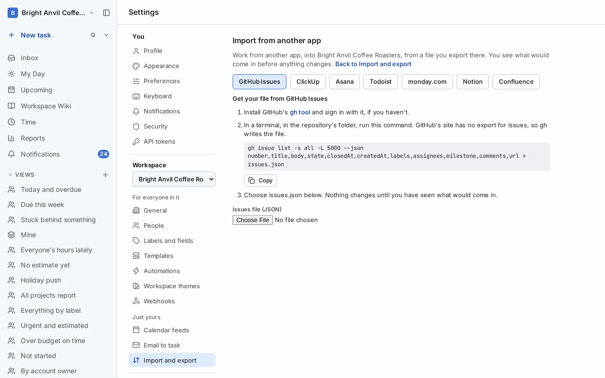

# Exports and imports

Settings, Import and export is where you export a workspace and import one. It applies to the workspace picked under Workspace in Settings.

## Exporting

Choose a format and choose Export, followed by the workspace's name. The export is made in the background on the server, so it needs a connection. You get a notification when it is ready, and you can download it for 7 days. Your exports are listed on the same page, where you can also delete them.

There are limits, each with its own message:

- Three exports can be on the way at once.
- You keep up to 10 exports. Delete one you have downloaded to make room, or wait for one to expire.
- You can start 10 exports an hour.
- No export starts while the server is almost out of disk space. Tell whoever runs it.

Your exports of a workspace are deleted if you leave it or become a guest in it. A guest's exports go too when a project is taken away from them.

An export holds the workspace as you see it. A guest's export holds only the projects shared with them. It has names but no addresses, and says "Someone" for another guest they share no project with.

| Format | Holds | Mila can import it |
|---|---|---|
| JSON | Everything, the wikis too, with attachments and history | Yes |
| CSV | A spreadsheet per project, a row per task, a column per field. Tasks in the Inbox have their own, and time logged goes in `Time logged.csv` | Not as a whole. Each spreadsheet can go through the [CSV import](#importing-a-csv-file) |
| Markdown | A folder per project and for the Inbox, a file per task and per wiki page, for Obsidian or any editor | No |

Each wiki in a Markdown export is a Wiki folder, with a file per page and a folder for each page's subpages. Links between pages and tasks point at their files.

## Importing a JSON export

A JSON export, from this Mila or another, comes back as a new workspace that you own. It can be up to 256 MB unless whoever runs your Mila changed that. A zip that unpacks into far more than its own size, its files included, is refused. Exports Mila makes always fit.

1. Under Import, choose the `.zip` file.
2. Choose how to treat IDs.
3. Choose Import.

The IDs choice:

- New IDs works always, even while the original workspace is still here.
- Keep the original IDs is for moving a workspace to this Mila. It is refused if any of them is already here.

The import runs in the background, and the new workspace appears when it is complete.

What comes across:

- Your own My Day, reminders and views come with it.
- Other people's assignments do not, and what others wrote is credited to you.
- Links and images in notes and wiki pages point at what came in with them.
- [Automations](automations.md) come across switched off. Turn on the ones you want.

This is also how to move a workspace from the [desktop app](desktop-app.md) on your own computer to a server, or back: export it in one place and import it in the other. The two are not kept in step afterward.

## Importing a CSV file

A CSV import brings in tasks from a spreadsheet or another app, into the workspace picked under Workspace in Settings. It runs on your device, so it works offline. Choose Import a CSV file on Settings, Import and export. Guests cannot use it.

The file can be up to 20 MB and 5,000 rows, and must have headings in its first row.

1. Choose the file.
2. Under Columns, say what each column means. Mila guesses from the headings, and from your custom fields' names, and shows sample values.
3. Choose where rows with no project go: a new project, one you have, or the Inbox.
4. Choose Check the import.
5. Read the result, then choose Import.

A column can be Title, Notes, Project, Status, Priority, Start date, Due date, Due time, Completed, Labels, Assignees, one of your custom fields, or Leave out. One column must be the title.

Check the import changes nothing. It says how many tasks would come in and where, which projects, statuses, labels and field choices it would make, which rows it would leave out and why, and anything else to warn you about, row by row. A row with no title is left out.

Dates are read in the form `2026-11-03`.

If it was not what you wanted, Move them to the trash appears once it finishes, and takes all the imported tasks out in one go.

## The API

Scripts and other apps can read and change your workspaces through Mila's API, as you, with the same rules as the app. The reference, at `/api/docs` on your Mila, lists every endpoint and lets you try them.

## Next

- [The trash and the archive](trash-and-archive.md)
- [Your account and backups](account-and-backups.md)
