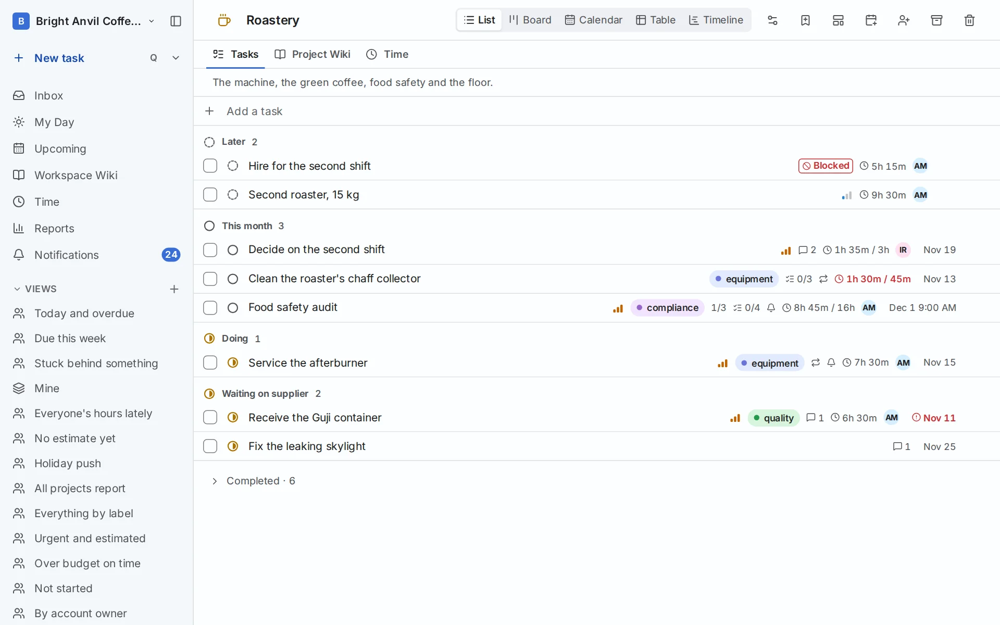
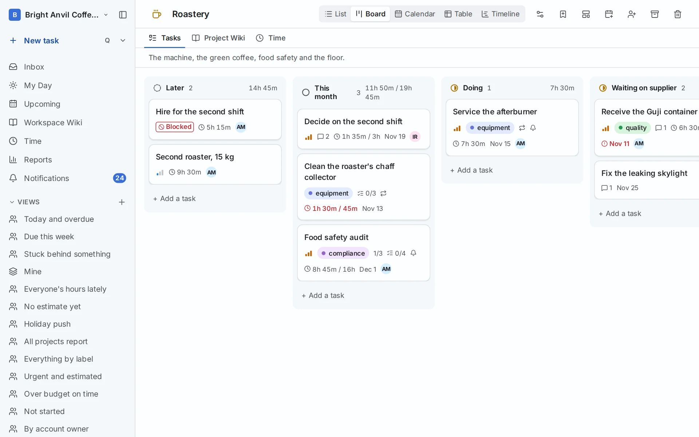
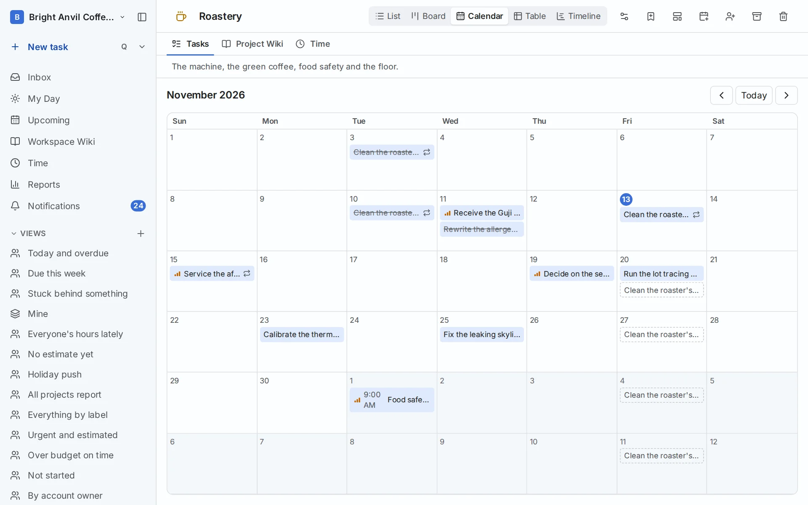
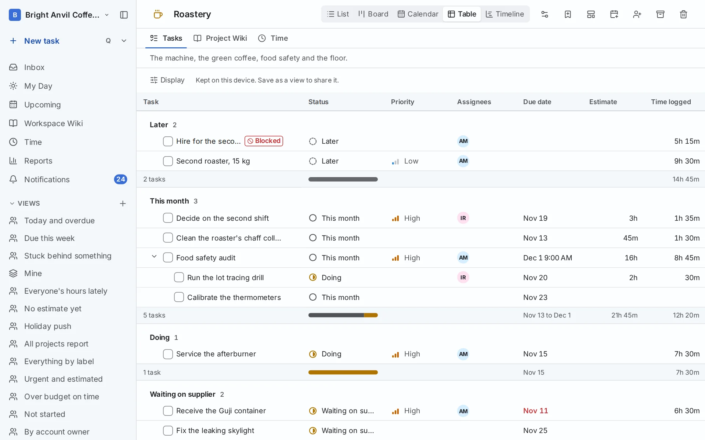
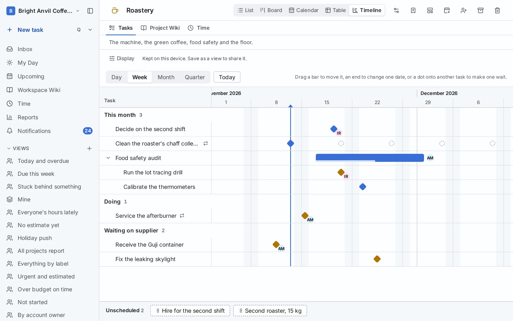

# Layouts

A project, or a [saved view](saved-views.md), can show its tasks five ways: list, board, calendar, table and timeline. Switch with the buttons at the top of the page. The tasks stay the same.

Inbox, My Day and Upcoming can show all five too. See [Other ways to see them](daily-lists.md#other-ways-to-see-them).

In every layout, right-click a task for its [menu](menus.md), or on a phone hold your finger still on it. In a list, a board or a table you can also [select several tasks](selecting-tasks.md) and change them all at once.

## List

Rows, in the order you give them. Drag a row to move it, or use `Alt+Up` and `Alt+Down`. [Keys on a task in a list](tasks.md#keys-on-a-task-in-a-list) has the rest.

On a phone, swipe a row right to complete it and left to schedule it. Swipes start away from the sides of the screen, which belong to your phone's back gesture. The date button on every row offers the same scheduling, so nothing needs a swipe.

## Board

A column for each of the project's statuses. A saved board can have other columns: see [Sort, group and show](saved-views.md#sort-group-and-show).

A board of tasks from every project, such as My Day's or a view across projects, has a column for each priority, since each project has statuses of its own, and each card shows its project. Display can make its columns the due date or a select or person field every project shares instead. Upcoming's board starts with its own days. See [Other ways to see them](daily-lists.md#other-ways-to-see-them).

Drag the edge between two columns to make every column wider or narrower, or focus the first edge and use the arrow keys. Double-click an edge to put them back. The width is kept on this device, for every board.

Drag a card to another column. With the keyboard:

| Key | Does |
|---|---|
| Arrow keys, `Home`, `End` | Go between cards |
| `Enter` | Open the card |
| `Alt+Left`, `Alt+Right` | Move the card to another column |
| `Alt+Up`, `Alt+Down` | Move the card within its column |

Board cards do not swipe on a phone, because the board scrolls sideways.

With several cards selected, drag one of them to another column and the others go with it.

When the columns are the project's statuses, right-click a column's heading for New task here, Rename the status, Its kind, Move left, Move right and Delete the status.

## Calendar

Each task sits on its due date. Tasks with no due date do not show. The buttons at the top go to the previous or next month, or back to Today.

Drag a task to another day. On a focused entry, `Alt+Left` and `Alt+Right` move it a day, and `Alt+Up` and `Alt+Down` a week.

The coming dates of a task that repeats on a schedule show faintly. One that repeats after completion has no dates to show until you finish it.

On a phone the calendar is a list of the days that have something on them.

## Table

A task on each row and a field in each column, with each task's subtasks indented under it. The arrow beside a task folds its subtasks away. In a saved view, a subtask the filter finds shows under its task, even when the task itself does not match. The other layouts filter only top-level tasks, except Timeline, which works the same way.

### Sorting

Click a heading to sort by it: once for ascending, again for descending, and a third time to stop. Shift-click a heading to add it as a second or third key. The small numbers say the order.

### Columns

Drag a heading to move its column, or its right edge to make it wider or narrower; the edge shows as you point at the heading. On a heading, `Alt+Left` and `Alt+Right` move its column too, and `Alt+Shift+Left` and `Alt+Shift+Right` make it narrower or wider. The task column stays first. Display, Reset order and widths puts the columns back.

### Changing cells

Click a cell to change it. Status, priority, assignees, dates, project, labels and custom fields each open a picker, and `Escape` closes it. The title opens the task, and the pencil beside it renames it in place, as does `F2`. The keys for tasks in a list work on any cell of a row.

With the keyboard, the arrow keys, `Home` and `End` go between cells. On a task's title, Left folds its subtasks and Right shows them. `Enter` edits a cell. On a heading, `Enter` sorts by it and `Shift+Enter` adds it to the sort.

### Summaries

Each group ends in a summary row. Click a summary to choose what it works out for its column: a count, a sum, an average, the smallest or largest number, a range of dates, the earliest or latest, how many are overdue, a bar of how the group divides up, or how many tasks have a value.

Summaries count subtasks too. Estimates and time logged are each task's own, so a parent and its subtasks are never counted twice. A task that shows only because of a subtask under it is not counted.

### Moving rows

When the table is not sorted, drag a row by the handle at its start, or use `Alt+Up` and `Alt+Down`. Dropping it in another group gives it what that group stands for: its status, priority, project or choice. A subtask moves among its own siblings, and dragging never makes a task a subtask.

A project's table keeps its layout on your device. Save as a view keeps it in a view. On a phone, a table shows as a list, with the same sort, grouping and fields.

## Timeline

Each task is a bar from its start date to its due date. A task with only a due date is a filled diamond on that day, and one with only a start date an open diamond. A repeating task shows its next few dates as faint diamonds.

Arrows run from the end of a task to the start of each task that waits for it. See [Dependencies](dependencies.md).

Zoom to show days, weeks, months or quarters. Today brings today, marked by a line, into view. Subtasks sit under their task: fold them away with the arrow beside it, and a bracket shows the dates they span. A saved view keeps its zoom, and a project keeps it on the device.

Drag the right edge of the Task heading to make the task names wider or narrower, or focus it and use the arrow keys. The width is kept on this device, for every timeline.

On a phone the titles sit on the bars, and the timeline shows weeks or months.

### Moving tasks

Drag a bar to move the task, keeping its length, or drag either end to change one date. Dragging a diamond moves its one date.

| Key, on a focused task | Does |
|---|---|
| Arrow keys, `Home`, `End` | Go between bars. Left folds a task's subtasks and Right shows them |
| `Enter` | Open the task |
| `Alt+Left`, `Alt+Right` | Move earlier or later: a day at Day zoom, a week at Week zoom, a month at Month and Quarter zoom |
| `Alt+Shift+Left`, `Alt+Shift+Right` | Move only the due date |

When a task moves later than a task waiting for it starts, Mila offers to move every task down the chain by the same number of days.

### Drawing dependencies

Point at a bar to show a dot before it and a dot after it. Drag the dot after a task onto another to make that one wait for it. Drag the dot before a task onto another to make it wait for that one. On a phone, add dependencies from the task's panel.

### Tasks with no dates

Tasks with no dates wait in the Unscheduled tray under the timeline. Drag one onto the timeline to make it due on that day, or choose it to make it due today.

## Next

- [Saved views](saved-views.md)
- [Filters](filters.md)
