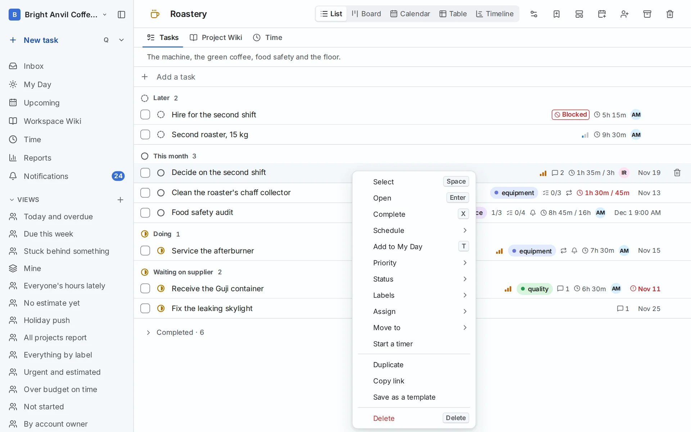

# Right-click menus

Right-click a task, a view or a project for what you can do to it, without opening it first. Everything in a menu is somewhere else in the app too, done the same way and with the same Undo. A menu is a shortcut, never the only way. The one exception is Duplicate on a task, which only the menu has.

A menu offers only what you may do. A guest, for example, does not see Move to or Save as a template.

## Where menus are

| Right-click | Where |
|---|---|
| A task | Wherever it shows: lists, boards, tables, calendars and timelines, My Day, Upcoming, subtasks in a task's panel, and a view in a wiki page |
| A view | In the sidebar, and its name at the top of its own page |
| A project | In the sidebar, on the Projects page, and its name at the top of its own page |
| A wiki page | In the tree of pages |
| A board column | Its heading, when the board's columns are statuses |
| A comment | On a task |
| A file | In a task's Files section |
| A label | On a task's row |

## A task's menu

From the top:

- Select, which starts [selecting several tasks](selecting-tasks.md), or Take out of the selection
- Open
- Complete, or Reopen
- Schedule: Today, Tomorrow, Next week, No date, or Pick a date
- Add to My Day, or Take out of My Day
- Priority, Status, Labels and Assign, each a list one step in
- Move to, which lists the Inbox and the workspace's projects
- Start a timer, or Stop the timer
- Duplicate
- Copy link
- Save as a template, which opens the task with the template dialog. See [Templates](templates.md)
- Delete

The keys beside an item are the ones that do the same from a list, as Settings, Keyboard has them. A check beside a choice, such as a priority or a label, means the task has it. Labels and Assign stay open, so you can tick several.

Delete asks nothing. The message after it has Undo, and the task waits in the [trash](trash-and-archive.md) for 30 days.

A task that is selected with others has the selection's menu instead, named for how many there are, and it acts on all of them. See [Selecting tasks](selecting-tasks.md#the-bar).

### Duplicate

Duplicate makes a copy just under the task, named like it with "(copy)" after the title. The copy has the task's notes, checklist, labels, assignees, custom fields and open subtasks, on the same dates. A subtask's copy stays under the same parent.

Nothing that happened to the task comes along: not its comments, time logged, files or history. The message after it has Open and Undo.

## A view's menu

Open, Open in a new tab, Rename, Filters and display, Share with the workspace, Duplicate, Copy link and Delete.

Duplicate makes a copy named like the view with "(copy)" after it. A copy of your own view is yours, and a copy of a shared view is shared. Rename, Filters and display, and Delete are offered on views you can change. Share with the workspace shows on your own views. See [Saved views](saved-views.md).

## A project's menu

Open, Open in a new tab, Open its wiki, Rename, Color and icon, Share with guests, Subscribe in a calendar app, Save as a template, Copy link, Archive and Delete.

Color and icon lists the colors, then Choose an icon. An archived project has Unarchive in place of Archive. Delete asks nothing, and the message after it has Undo. See [Projects](projects.md) and [The trash and the archive](trash-and-archive.md).

## Other menus

| Menu | Holds |
|---|---|
| A wiki page | Open, Open in a new tab, New page under it, Rename, Copy link, History, Save as a template, Delete. A wiki's main page has no Rename or Delete. See [The wiki](wiki.md) |
| A board column | New task here, Rename the status, Its kind, Move left, Move right, Delete the status. Deleting a status moves its tasks to another, with Undo. See [Statuses](projects.md#statuses) |
| A comment | Copy text, Copy link to the task, and on your own comments Edit and Delete. Admins and owners can delete others' comments. See [Comments](comments.md) |
| A file | Open, Download, Copy link, Delete |
| A label | Take it off this task, and Edit the label, which opens Settings, Labels and fields |

## From the keyboard

With a task, view or project focused, press `Shift+F10` or the Menu key, and its menu opens beside it.

| Key | Does |
|---|---|
| Up, Down, `Home`, `End` | Move through the menu |
| Right | Open a list one step in, such as Priority |
| Left | Go back from that list |
| `Escape` | Go back from a list, or close the menu |
| `Tab` | Close the menu |

A list one step in takes the menu's place, with Back at its top. When the menu closes, focus goes back to where it was.

## Your browser's own menu

In text, such as notes, a page, a field or words you have selected, a right-click is always the browser's, for spelling, cut, copy and paste.

Anywhere else without a menu of Mila's, a right-click in a browser is the browser's own menu. In the [desktop app](desktop-app.md) it does nothing there, since that menu's Back and Reload would act on the app itself.

## On a phone

Hold your finger still on a task, view or project for half a second, and the same menu comes up from the bottom of the screen. Moving your finger instead scrolls or swipes, as before. The same works on the other things that have menus.

## Next

- [Selecting tasks](selecting-tasks.md)
- [Keyboard shortcuts](keyboard.md)
