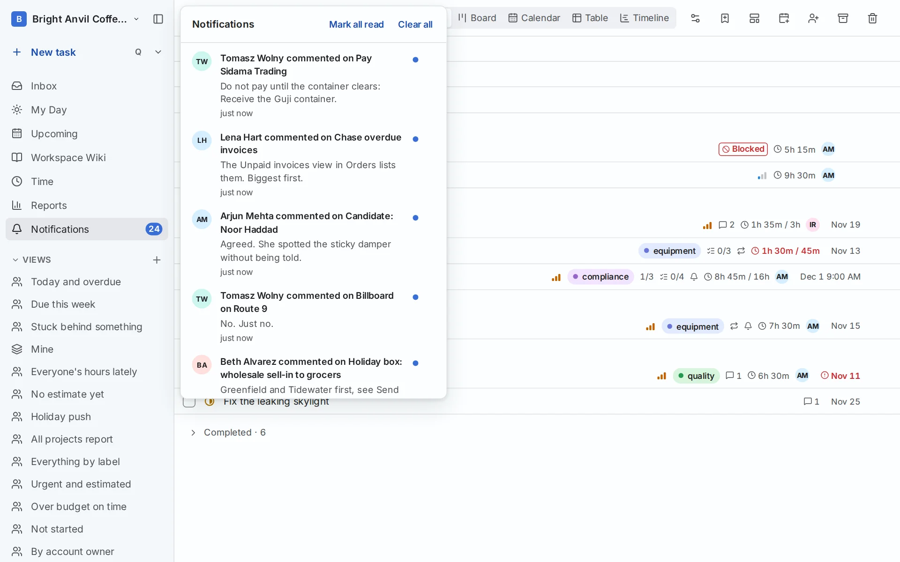

# Notifications

Mila tells you about what concerns you in up to three places: the bell in the app, a push to a phone or computer, and email. You choose which, kind by kind, in Settings, Notifications.

You are never told about your own changes, and you only hear about tasks you can see.

## The bell

The bell in the sidebar shows how many notifications you have not read. On a phone it is in the top bar. Opening one takes you to its task and marks it read. Mark all read clears the count.

Choosing a push or an email's link also marks its notification read, and switches to the right workspace.

## Clearing notifications

The X beside a notification clears it. Clear all, at the top of the list, asks "Clear them all?" and clears the whole list when you choose Clear. Any email or push still waiting to go out for what you clear goes with it.

Clearing is for good, on all your devices. It takes away only the notification, never the task or comment it was about.

When a workspace, project or task is deleted, its notifications go too, read or not. If it is restored from the trash, they come back.

## What reaches you, and where

| Kind | When | App | Push | Email |
|---|---|---|---|---|
| Mentions | Someone mentions you in a comment | Always | On | On |
| Assigned to you | Someone gives you a task | On | On | Off |
| Comments | On tasks you made or are assigned to | On | Off | Off |
| Comments on pages | In threads on wiki pages you wrote in | On | Off | Off |
| Ready to start | A task of yours was waiting for one that is now done | On | On | Off |
| Due tasks | Your tasks reach their due time | On | On | On |
| Reminders | Reminders you set on tasks | Always | On | On |
| Tasks from email | Mail you sent to one of your [addresses](email-to-task.md) became a task | On | Off | Off |
| Automations | An [automation](automations.md) tells you something, or one of yours stops | On | On | Off |
| Accepted invites | Someone joins through your invite | On | Off | On |

The table shows how things start. Tick or untick any box in Settings, Notifications, and it saves as you go. Mentions and reminders always show in the app, where the list is their record.

Exports and imports also tell you in the app when they finish.

## Email

Send a test email, in Settings, Notifications, checks that email reaches you. Email goes to your account's address. If your Mila has no email service set up, the page says so, and emails go to the server's log.

## The daily digest

The digest is one email a day, with your overdue tasks, the ones due that day, the notifications you have not read, what you logged yesterday, and which of your tasks are past their estimate.

Tasks in archived projects stay out of its due and over-estimate lists. They send no reminders or due notices either. See [The archive](trash-and-archive.md#the-archive).

It is off to begin with. Turn on Email me a daily digest, under Summaries by email, and choose the hour. On a day with nothing to say, no email comes.

## The weekly report

The weekly report is one email for each workspace you are in, on the first day of your week, at the same hour as the digest. It tells you about the week before, against the week before that:

- the tasks done and made, how many were overdue as it ended, and the median cycle time;
- a line for each project: done in the week, and open and overdue as it ended;
- the time you logged, and for members the time everyone logged;
- your tasks that are overdue, waiting on others or past their estimate, each with a link.

It counts only what you can see, as [Reports](reports.md) does. A week with nothing done, made or logged in a workspace sends nothing for it. Turn on Email me a weekly report in Settings, Notifications. Your first day of the week is the one in Settings, Preferences; with As this device does, it is the day your device starts its week on.

## Your time zone

Due times and the hour of the digest and the weekly report follow the time zone shown in Settings, Notifications. Mila takes it from your device each time it starts with a connection, so it follows you when you travel.

## Push

A push reaches a phone or computer even when Mila is not open.

Turn it on in each browser you want it in, with Push on this device in Settings, Notifications. Your browser asks for permission the first time. Send a test push checks that it arrives, and the page says how many of your devices have push on.

A push about a task replaces the last one about that task, and still alerts you. Choosing it opens the task.

In the [desktop app](desktop-app.md), what the bell tells you also shows as a notification from your system while the app is open, without turning push on.

What can stand in the way, each with its own message on the page:

- The server is not set up to send pushes.
- The connection is not secure. Push needs `https://`.
- The browser cannot receive pushes. On an iPhone or iPad, add Mila to the Home Screen (Share, then Add to Home Screen) and turn push on from there.
- Notifications are blocked for Mila in the browser. Allow them in the site settings, then reload the page.

Signing out turns push off for that browser. If someone else signs in there, they do not inherit it.

### Phone push and the 30-day rule

Push on a device lasts only as long as your sign-in on that device.

A sign-in lasts 30 days from the last time you used Mila on that device, and at most 90 days from when you signed in. See [How long you stay signed in](signing-in.md#how-long-you-stay-signed-in). When it ends, pushes to that device stop.

A phone that has not opened Mila for 30 days stops getting pushes, even if you are using Mila every day on a computer. Receiving a push does not count as using Mila.

Three days before that, Mila sends the device one push that says "Open Mila to keep notifications on this device." It says nothing about your work. Opening Mila renews the 30 days and brings the device's push up to date.

The 90-day limit cannot be put off by using Mila. Three days before it, the push says "Sign in to Mila again to keep notifications on this device." Choosing it takes you to sign in, and a new sign-in in time keeps push on.

If pushes have stopped:

1. Open Mila on the phone and sign in again.
2. Go to Settings, Notifications and turn on Push on this device again. Signing in does not bring it back by itself.
3. Choose Send a test push to check.

Email and the bell do not depend on a device's sign-in, so a mention or a reminder also waits for you there, if you left those on.

## Next

- [Preferences](preferences.md)
- [Calendar feeds](calendar-feeds.md)
