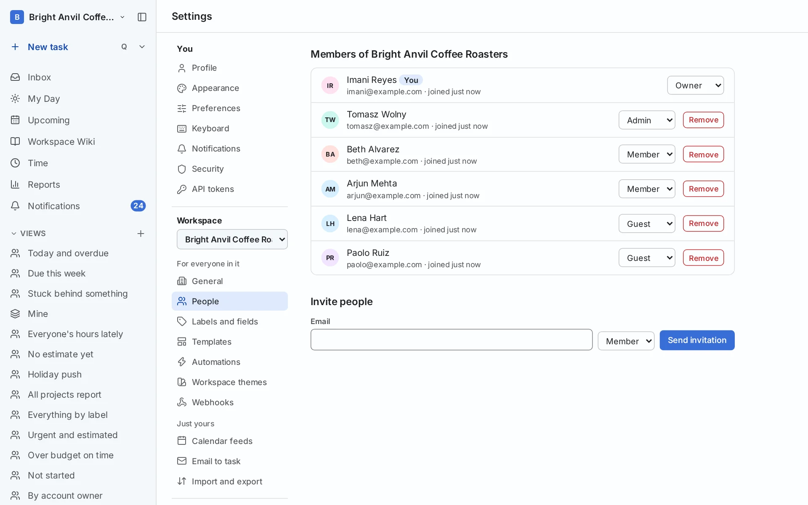

# People and roles

This page is for whoever runs a workspace: inviting people, choosing their roles, and sharing projects with guests.

A workspace with other people in it has to be a shared one. Your Personal workspace is just for you. To make a shared one, open the workspace menu at the top of the sidebar and choose New workspace.

## Roles

Everyone in a workspace has one role.

| | Guest | Member | Admin | Owner |
|---|---|---|---|---|
| Sees every project and the Inbox | | Yes | Yes | Yes |
| Sees the workspace's wiki | | Yes | Yes | Yes |
| Sees projects shared with them | Yes | Yes | Yes | Yes |
| Works on tasks and wiki pages where they can see them | Yes | Yes | Yes | Yes |
| Makes and changes projects, statuses, labels and fields | | Yes | Yes | Yes |
| Makes and changes saved views | | Yes | Yes | Yes |
| Uses templates | | Yes | Yes | Yes |
| Makes automations for a project | | Yes | Yes | Yes |
| Has email-to-task addresses | | Yes | Yes | Yes |
| Sees everyone's email address | | Yes | Yes | Yes |
| Makes calendar feeds and exports of what they can see | Yes | Yes | Yes | Yes |
| Renames the workspace | | | Yes | Yes |
| Invites people and changes members | | | Yes | Yes |
| Shares projects with guests | | | Yes | Yes |
| Publishes workspace themes | | | Yes | Yes |
| Makes automations for the whole workspace | | | Yes | Yes |
| Adds webhooks | | | Yes | Yes |
| Changes or deletes anyone's logged time | | | Yes | Yes |
| Deletes the workspace | | | | Yes |

Admins manage members and guests. Only an owner can change or remove another admin or owner, or invite or appoint an owner. An admin can make someone an admin.

A workspace always keeps at least one owner. To step down, make someone else an owner first.

Separately, someone running the Mila server can be an instance admin. That role covers the server, whatever their workspace roles: it shows a Settings, Admin page with every account, open invitations, and the state of backups. See [Your account and backups](account-and-backups.md).

On Settings, Admin, the Admin switch beside an account makes that person an instance admin. Turning it on needs a sign-in from the last 10 minutes, with a passkey if you have one. See [Signing in again for sensitive changes](signing-in.md#signing-in-again-for-sensitive-changes).

Sign out everywhere, beside an account, takes a second click to confirm. It ends that person's sessions on every device, their API tokens, calendar feeds and email-to-task addresses, and any change of address or sign-in link they had asked for, and it removes their passkeys. They are emailed, and sign in again with an email link. Use it when an account may be in someone else's hands.

## Inviting someone

1. Go to Settings, People, for the workspace picked under Workspace in Settings, and find Invite people.
2. Type their email address, choose a role and choose Send invitation.

The invitation expires after 7 days. Open invitations are listed below the form, with a Cancel button. A workspace can have 50 waiting.

A person with no account gets one when they accept. See [Getting an account](signing-in.md#getting-an-account). If Mila has no email set up, the invitation goes to the server's log instead of to an inbox, so ask whoever runs it.

An invitation works only while its sender can still send it. If the sender is removed or loses the role, it stops working.

An invitation as an admin or an owner can be accepted only from the address it was sent to. Someone signed in with another address is asked to sign out first. An invitation as a member or a guest joins whoever opens it while signed in. When that isn't the address it was sent to, the page says so before anything happens, and offers both: Sign out first, to accept it as that address, or join as yourself. Someone already in the workspace is told so, with a button to open it. Signing out there waits while the device has changes not sent yet: open Mila so they go, then come back to the link.

You get an Accepted invites notification when someone joins through your invitation.

## Changing roles and removing people

Settings, People lists the members with their names, addresses, roles, and when they joined. Choose a new role beside a person, or remove them, as far as your own role allows.

Changing a role to or from guest makes that person's devices load the workspace afresh. A guest who becomes a member loses their list of shared projects, since members see them all. If they become a guest again, they start with none. A member who becomes a guest loses their email-to-task addresses and exports for the workspace, and automations that run as them stop.

Anyone can leave a workspace with Leave on Settings, General, under Your membership, except its last owner. Nobody can leave or be removed from a personal workspace.

When someone leaves or is removed:

- their calendar feeds for that workspace end
- their email-to-task addresses for it end
- their exports of it are deleted
- their notifications from it are deleted
- automations that run as them stop, and say so, until someone saves them again (see [Automations](automations.md#whose-rule-it-is))
- webhooks that belong to them are paused, and the owners and admins are told (see [Webhooks](api-and-webhooks.md#webhooks))
- their comments keep their name

## Sharing a project with a guest

Members and above see every project. Guests see only those shared with them.

1. Invite the person as a guest, in Settings, People.
2. Open the project and choose Share with guests, the button with a person and a plus in its header.
3. Tick their name.

Their devices load the project straight away. Untick their name to take the project away. It disappears from their devices, along with their notifications about it.

The dialog lists all the workspace's guests, so you can share one project with several, and one guest can have several projects.

[If you are a guest](guests.md) is the page to send a guest.

## Who can see whom

Everyone in a workspace can see names and pictures. Comments and mentions need that. Beyond that:

- Members, admins and owners see everyone, with email addresses, in Settings, People.
- Guests see names and pictures, and never addresses. A guest has no Settings, People; Settings, General shows them only their own membership.
- Guests see all the members and admins and owners.
- Guests see other guests only when they share a project with them.

People's pictures can be seen only by those who share a live workspace with them, and by instance admins.

## Who is told what

The `@` list in a comment shows who can reach that task: the workspace's members, and guests the project is shared with. See [Comments](comments.md#mentioning-someone).

The assignee list works the same way: it offers who can reach the task. See [Assignees](tasks.md#assignees).

A person only ever hears about tasks they can see. Mentioning someone who cannot see a task tells them nothing, and a task cannot be assigned to someone who cannot reach it: Mila takes the assignment back and says so.

## Renaming and deleting a workspace

Rename a workspace at the top of Settings, General, for the workspace picked under Workspace in Settings.

Owners can delete a shared workspace, at the end of the same page, with a second click to confirm. This removes it for everyone in it. It does not go to the trash, and the app has no way to bring it back. An [export](exports-and-imports.md) first gives you a copy.

A personal workspace cannot be deleted while its account exists.

## Next

- [If you are a guest](guests.md)
- [Notifications](notifications.md)
