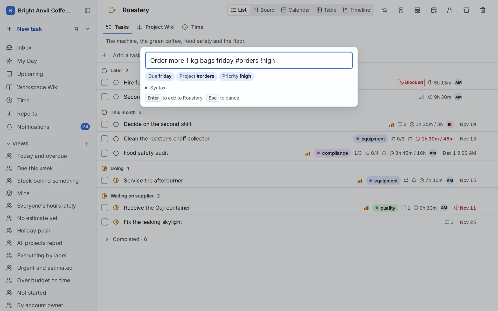

# Quick add

Quick add makes a task from one line of text. Open it with `q`, with New task in the sidebar, or with the round add button on a phone. In the [desktop app](desktop-app.md), `Ctrl+Shift+Space` brings Mila forward and opens quick add, whichever program you are in.



As you type, a chip appears for each part Mila understood, so you can see what you will get. Anything it does not understand stays in the title, so nothing you type is lost.

For example:

```
Call Dana tomorrow 3pm #work !high
```

This makes a task called "Call Dana", due tomorrow at 3 PM, in the project Work, with high priority.

`Enter` adds the task and closes quick add. `Escape` closes it without adding, as does Cancel on a touch screen. Syntax, under the field, is a short reminder of what follows.

## Where the task goes

With no project named, the task goes to the project on screen (a project, or a saved view of one project). Otherwise it goes to the Inbox. The line under the field says which. Added from My Day, it also goes into My Day.

Guests cannot add to the Inbox, so they should name a project or start from one. See [If you are a guest](guests.md#what-you-cannot-change).

## Everything it reads

| Write | To set | Notes |
|---|---|---|
| `#work` | Project | The start of the name is enough, and a whole-name match wins. Write spaces as hyphens: `#home-repairs` finds Home repairs. Only the first one counts |
| `!high` | Priority | `!urgent`, `!high`, `!medium` or `!med`, `!low`, or `!1` (urgent) to `!4` (low) |
| `@dana` | Assignee | A person, by the start of their name. You can name several |
| `+phone` | Label | A label that already exists, by the start of its name. You can add several. A label that does not exist stays in the title |

## Dates

These set the due date. You can put "on", "due" or "by" in front of any of them.

| Write | Means |
|---|---|
| `today`, `tomorrow`, `tmr` | As they say |
| `fri`, `friday` | The next Friday, never today |
| `next week` | The first day of next week, as your week starts in [Preferences](preferences.md) |
| `next fri` | The Friday after the coming one |
| `in 3 days`, `in 2 weeks` | That far from today |
| `nov 14`, `14 nov`, `11/14`, `2026-11-14` | That day. In `11/14` the month comes first. A day that has passed this year means next year |

## Times

These set the due time, with or without "at" in front: `3pm`, `3:30pm`, `15:00`, `noon`, `midnight`.

A time with no date means today.

## Repeats

| Write | Repeats |
|---|---|
| `every day`, `daily` | Each day |
| `every weekday` | Monday to Friday |
| `every week`, `weekly` | Each week |
| `every 2 weeks` | Every second week |
| `every other month` | Every second month |
| `every monday` | On that weekday |
| `every mon and thu` | On those weekdays |
| `monthly`, `yearly` | Each month or year |

With no date, the task is due on the first day the repeat falls on. See [Repeats](schedule.md#repeats).

## Reminders

A line can carry one reminder for you.

Before the due time: `remind 1h before`, `remind 30 minutes before`, `remind 2 days before`. This needs a due date. A task with no due time counts as due at 9:00.

At a moment: `remind 3pm`, `remind tomorrow 9am`, `remind me fri at 8:30am`.

- A time alone is on the due date. With no due date it is today, or tomorrow once that time has passed.
- A date alone is at 9:00.
- A reminder that would already be past stays in the title.

## A few complete lines

```
Pay rent every month nov 1 #home
Standup every weekday 9:30am
Dentist fri 10am remind 1h before
Review the contract next week @dana +legal !2
```

## Next

- [Tasks](tasks.md)
- [Dates, repeats and reminders](schedule.md)
