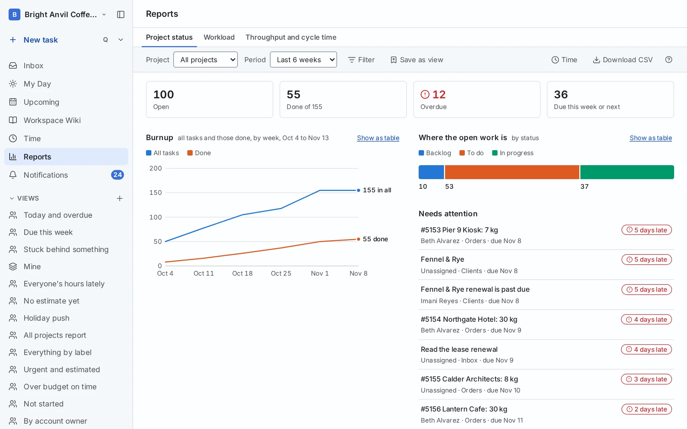
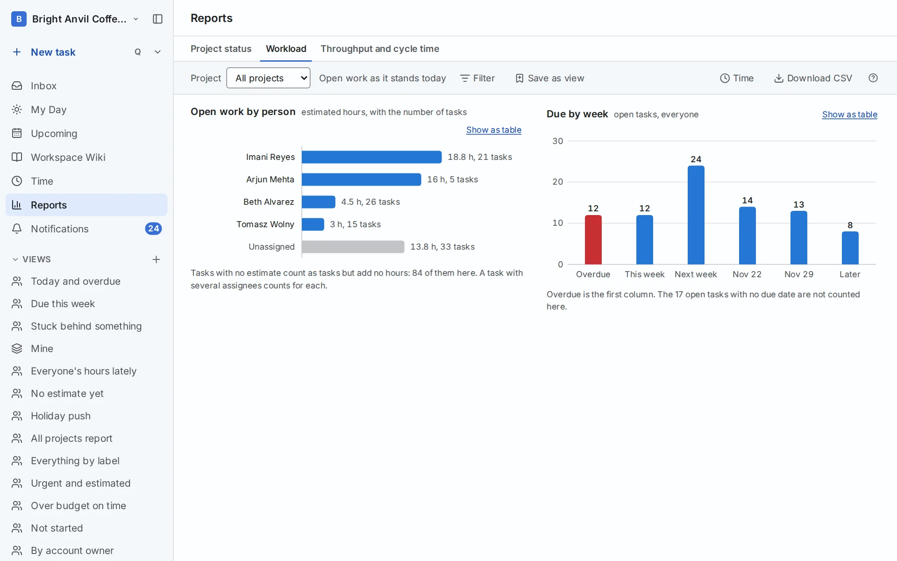

# Reports

Reports, in the sidebar, shows how work is going, in three tabs: Project status, Workload, and Throughput and cycle time. Your device works them out from the tasks it holds, so they work offline and count only the tasks you can see. A guest's reports cover the projects shared with them.

Reports count every task, subtasks too, in the inbox and the projects in use. Tasks in the trash, tasks in archived projects and canceled tasks are left out. A task you reopen counts as open until you finish it again. Time logged has a page of its own, [Time](time-tracking.md#the-time-page), which Reports links to.

## One project, a filter and a period

Project, at the top, shows every tab for one project or for all of them. With one project, Tasks by status uses that project's own statuses, in its order. A project's [menu](menus.md) has Open its reports.

Filter narrows every tab to the tasks you choose, the same way a [saved view's filter](filters.md) does. The period sets the weeks the charts cover: the last 6 weeks, the last 3 months, this year, or dates you pick. Weeks start on the day set in your [preferences](preferences.md).

The tab, project, filter and period are kept on this device for each workspace.

## Project status

The tiles count what is open, what is done out of all the tasks, what is overdue, and what is due by the end of next week. The burnup draws all the tasks there were and how many were done, week by week; when the lines meet, everything is done.

Where the open work is splits open tasks by the kind of their status. Needs attention lists open tasks that are overdue, waiting on unfinished tasks, or past their estimate. Below them are tasks by status, open work by priority, how overdue, and open work by label and by project.

## Workload

Open work by person adds up each person's estimated hours and counts their open tasks. A task with several assignees counts for each; one with no estimate counts as a task but adds no hours. There is nothing to set about anyone's capacity: the chart shows the load, and you judge it.

Due by week counts open tasks by the week they are due, overdue first. Workload is open work as it stands today, so it has no period.

## Throughput and cycle time

Made and done each week shows whether work is piling up. Cycle time is how long a task took from the first time it went to a status of kind in progress until it was done: the typical time, the time within which 8 in 10 were done, and how many took how long. Tasks done without ever going in progress are left out of it. Cumulative flow stacks to do, in progress and done for each day, and cycle time task by task shows each finished task as a dot.

## Saving a report, and reports in pages

Save as view keeps the report as it is set up, the tab, period, project and filter, as a view of its own kind in the sidebar. Only you see it until you share it, like any [saved view](saved-views.md). A shared saved report can go in a wiki page or a task's notes, one chart at a time, from the `/` menu's Report (see [Writing](writing.md)).

Show as table puts a chart's numbers in a table in its place, and Download CSV saves a tab's tables. Point at a chart, or tap it, to see its numbers; from the keyboard, the arrow keys step through it.

## By email

The [weekly report](notifications.md#the-weekly-report) brings a summary of each week to your inbox, worked out by the same rules: what was done and made, what is overdue, each project, the time logged, and what needs you.

## Next

- [Time tracking](time-tracking.md)
- [Saved views](saved-views.md)
