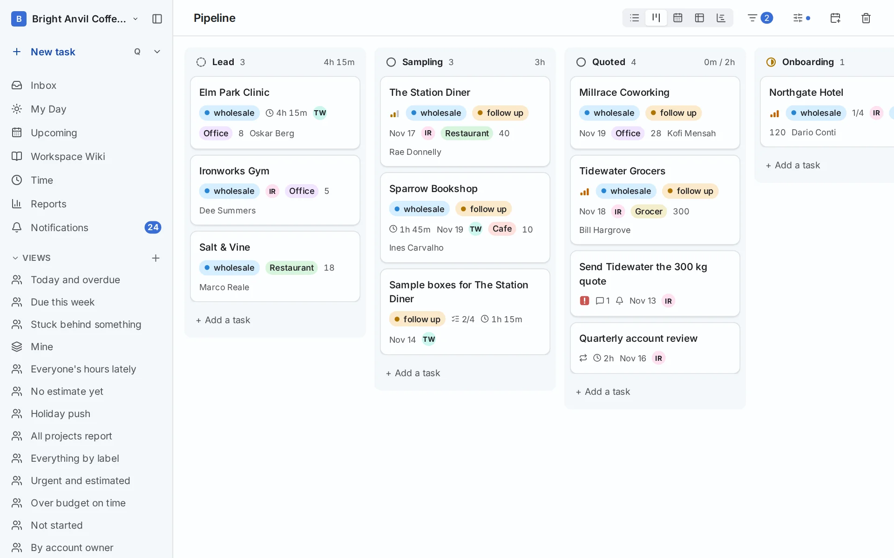

# Saved views

A saved view keeps a layout, a filter and how tasks are arranged under a name in the sidebar. Use one for a question you ask often: "my open tasks", "what is blocked", "everything for this client by due date".

## Making a view

The plus beside Views in the sidebar makes a new view across every project, named New view. It starts out showing the tasks assigned to you.

The bookmark button on a project saves that project and its current layout as a view, named after them, such as "Kitchen board". A table or timeline brings its layout from this device with it.

Save as view, at the top of Inbox, My Day or Upcoming, saves what you set up there as a view, such as "Upcoming table". See [Kept on this device](daily-lists.md#kept-on-this-device).

Save as view, on the Reports page, saves the report as it is set up (the tab, the period, the project and the filter) as a report view, such as "Website launch report". It opens as the Reports page does, under its own name, and what a member changes there is saved to it. A report of one project always reports on that project.

Duplicate, in a view's right-click menu, makes a copy named like it with "(copy)" after it. A copy of your own view is yours, and a copy of a shared view is shared.

Click a view's name at the top of its page to rename it. Choose the trash button to delete it. A message offers Undo.

## A view's menu

Right-click a view in the sidebar, or its name at the top of its page, for Open, Open in a new tab, Rename, Filters and display, Share with the workspace, Duplicate, Copy link and Delete. You see only what you may do to that view. On a phone, hold your finger still on it. See [Right-click menus](menus.md).

## The sidebar

Views sit under Views in the sidebar. The arrow beside Views folds the list away, and each device remembers whether it is folded. The plus beside it opens the list again as it makes a new view.

## Layouts in a view

The buttons at the top switch a view between [layouts](layouts.md). A view across every project can take any of them. Its board has a column for each priority, or for the choices of a select or person field every project shares, since statuses are a project's own. A report view has no layouts to switch between; it shows the Reports page's tabs.

The line beside the name says what a view covers and who has it: `All projects · Only you`, or `Kitchen · Shared`.

## Sharing a view

A new view is yours alone. Share with the workspace, at the top of the view, makes it a shared view that everyone who can see its tasks finds in their sidebar.

Changes to a shared view, its filter and how it is shown, are saved for everyone as you make them.

A guest can change a shared view too, but only on their own screen. A note says "Changes here are only for you and are not saved", and Reset puts the view back. Guests cannot make their own views.

## Sort, group and show

Display, at the top of a view, chooses how its tasks are laid out. A calendar has no Display: it always puts tasks on their due dates, in order of time. A dot on the button means the view differs from the defaults.

### Sort

Sort orders tasks by up to three things in turn, such as due date and then priority. You can sort by title, priority, due date, start date, when a task was made, last changed or completed, status, project, estimate, time logged, time remaining, or one of your custom fields. Multi-select fields cannot be sorted, since they hold no one value.

Tasks with nothing to sort by, such as no due date, always come last. Without a sort, tasks keep the order you give them.

A sorted view has no order of its own to change, so moving a task up or down does nothing there except say so. Remove the sort to move tasks by hand again.

Each project keeps its own order, so in a view across projects you can move tasks up or down only when it is grouped by project.

### Group by

Group by puts a list or a table under headings: project, status, priority, assignee, label, due date (Overdue, Today, Tomorrow, This week, Later and No date), or a select or person field.

A task with two labels or two assignees shows under each of them.

### Columns

Columns sets a board's columns: the project's statuses, the priorities, the due date, or the choices of a select or person field. A board across projects has no Status choice, and only the fields every project shares. By due date, the columns are Earlier, Today, Tomorrow, the next five days by name, Later and No date; nothing moves into Earlier, and a card moved to Later is due the day after the week.

Moving a card to another column gives it that status, priority or choice, and a task added in a column starts with it. On a sorted board, cards move between columns but not up or down within one.

### Show

Show chooses what rows or cards carry beside the title, or a table's columns: status, project, priority, labels, subtasks, checklist, comments, repeat, reminders, assignees, start date, due date, estimate, time logged, remaining, and your custom fields.

A table shows every custom field until you hide it. A row with its due date hidden still has its schedule button.

## Calendar apps

Subscribe in a calendar app, at the top of a view, makes a [calendar feed](calendar-feeds.md) of it. The feed follows the view's filter, field conditions included, but not its sort or grouping.

## A view in a wiki page

A shared view can show inside a wiki page, as a list, a board or a table, and stays current as its tasks change. Everyone sees only the tasks they could see anyway. Personal views cannot go in a page. See [Writing in notes and pages](writing.md). A shared report view can show one of its charts in a page the same way.

## Next

- [Filters](filters.md)
- [Search and the command palette](search-and-palette.md)
