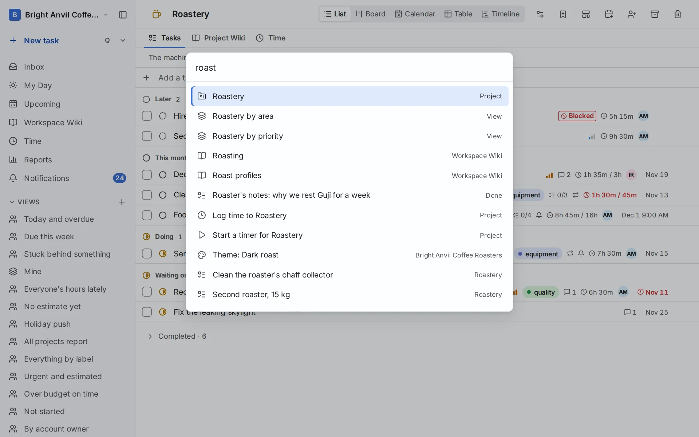

# Search and the command palette

The command palette finds things and does things by typing. Open it with `Ctrl+K` or `/`, from anywhere. On a phone it is the Search tab.

`Ctrl+K` works while you are typing in a field. `/` does not, since it would type a slash.

## What it finds

Type part of a name. Results come from:

- Tasks, by title and by what their notes say. Finished tasks rank lower and say Done
- Projects and saved views, by name
- Wiki pages, by title and by what they say
- Templates, except for guests. Choosing a page template makes a new page from it under the wiki page you are on, or else under the main page of the wiki of the project on screen, or of the Workspace Wiki when no project is on screen
- Help topics and their sections
- Commands

It shows the best 30. It searches this device's copy of the workspace you are in, so it works offline, and it does not reach other workspaces.

Move with the arrow keys and press `Enter`. `Escape` closes it.

## Commands

With nothing typed, the palette lists its commands, and each shows its key if it has one:

- Go to Inbox, My Day, Upcoming, Projects, the Workspace Wiki or Time
- Open the trash, settings, preferences, keyboard settings or help
- Add a task, and show the keyboard shortcuts
- Switch to light or dark, or follow the system
- Theme, Density and Font size choices, and Customize this theme
- Stop the timer, while one runs

## Acting on a task

If a task is focused in a list, or open in the panel, its commands come first:

- Start a timer on the task, or Stop the timer
- Log time on the task
- Complete the task, or Reopen the task
- Move the task to a project, which then asks where
- Due today, Due tomorrow, Clear the due date
- Add the task to My Day, or take it out
- Priority: Urgent, High, Medium, Low, None

The change shows a message with Undo.

A task's [right-click menu](menus.md) has most of these too, and to change several tasks at once, [select them](selecting-tasks.md). Results in the palette have no right-click menu.

## The shortcut sheet

`?` or `Ctrl+/` opens a quick sheet of the keys that work anywhere and where your focus is. It links to the full list at Help, Keyboard shortcuts. See [Keyboard shortcuts](keyboard.md).

## What it does not search

The palette does not search comments or custom fields. A [filter](filters.md#custom-fields) can find custom field values.

## Next

- [The wiki](wiki.md)
- [Keyboard shortcuts](keyboard.md)
