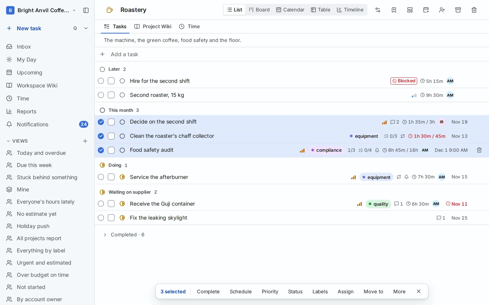

# Selecting tasks

Select several tasks, then change them all at once: complete them, give them a date, a priority, a status, labels or people, move them to another project, or delete them.

Selecting works in a list, a board or a table: a project's, a saved view's, and those of the Inbox, My Day and Upcoming. It does not work on a calendar, a timeline, search results or a view in a wiki page.

## Selecting with the pointer

- Hold `Ctrl` as you click a task to add it to the selection, or take it out. On a Mac, hold `Cmd`, since `Ctrl` and a click is a right-click there.
- Hold `Shift` as you click to select every task between the one you picked last and this one, in the order the list shows them, across its groups.
- Right-click a task and choose Select, the first item in its [menu](menus.md).

Once anything is selected, each task has a circle at its start. Click a circle to add the task or take it out, with no key held.

A plain click still does what it always does: the title opens the task, and the checkbox completes it.

## Selecting with the keyboard

| Key | Does |
|---|---|
| `Space` | Add the focused task to the selection, or take it out |
| `Shift+Down`, `Shift+J` | Stretch the selection down |
| `Shift+Up`, `Shift+K` | Stretch the selection up. Moving back takes off what you passed |
| `Ctrl+A` | Select every task the list holds, including ones further down that have not been drawn yet |
| `Escape` | Clear the selection |

While anything is selected, the task keys act on all of it: `x` completes, `t` adds to My Day or takes out, `1` to `4` and `0` set the priority, and `Delete` deletes. These are the defaults. `Space`, `Shift+J` and `Shift+K` can be changed in Settings, Keyboard, like the task keys.

## The bar

A bar comes up at the bottom of the page with the count and what you can do: Complete, Schedule, Priority, Status, Labels, Assign, Move to, and More, which holds Add to My Day, Copy links and Delete. The X at its end clears the selection.

Right-click a selected task for the same, as a menu named for how many there are. Right-clicking a task that is not selected acts on that task alone and keeps the selection.

Each change is one step, and the message after it has Undo for all of it.

The bar offers only what you may do to every selected task. Move to, for example, needs every subtask's parent to be selected with it, and is not offered to guests.

### When the tasks differ

The menus say how the tasks stand:

- Complete completes the open ones. When all of them are done, it says Reopen instead.
- A check beside a priority or a status means they all have it.
- In Labels and Assign, a check means all of them have it and a dash means some do. Choose a dash to put it on all of them, and choose a check to take it off all of them. These menus stay open, so you can choose several.
- Assign offers only people who can reach every selected task.

### Dates

Schedule's Today, Tomorrow, Next week, Pick a date and No date set the same due date on all of them. Pick a date asks for the date in the bar.

A day later and A week later move each task's own dates instead, keeping the gaps between them.

### Status and moving

For tasks in one project, Status lists that project's statuses. For tasks in different projects, it offers To do, In progress and Done, and each task takes its project's first status of that kind.

Move to works as moving one task does: each task takes a status of the same kind in its new project, and subtasks go with their parents. See [Projects](projects.md#statuses).

### Copy links

Copy links copies a list of links to the tasks, one line each, which you can paste into a wiki page.

## What stays selected

What you select stays selected as you scroll, open a task or make a change, so you can make another.

Going to another page clears it. A task that leaves the list, because it was moved somewhere else, filtered out or deleted, leaves the selection too, and comes back with Undo.

On a board, drag one of the selected cards to another column and the others go with it.

## Rules and other people

Your [automations](automations.md) run for each task you change, as if you had changed them one by one. A change to many counts once toward a rule's limit of 200 runs an hour.

Someone you assign several tasks at once gets one notification on their phone or computer for all of them, and a notification for each task in their list. See [Notifications](notifications.md).

If the server refuses some of the changes, those are put back, and a message says how many could not be saved.

## On a phone

Hold your finger on a task for its menu, and choose Select.

Until you tap Done, a tap selects a task instead of opening it, circles stand in for the checkboxes, and swipes are off. A strip at the top shows the count, with All, which selects the whole list, and Done. The bar takes the place of the tabs, with Complete, Schedule, Move to and More. On a phone, More also holds Priority, Status, Labels and Assign.

## Next

- [Right-click menus](menus.md)
- [Tasks](tasks.md)
