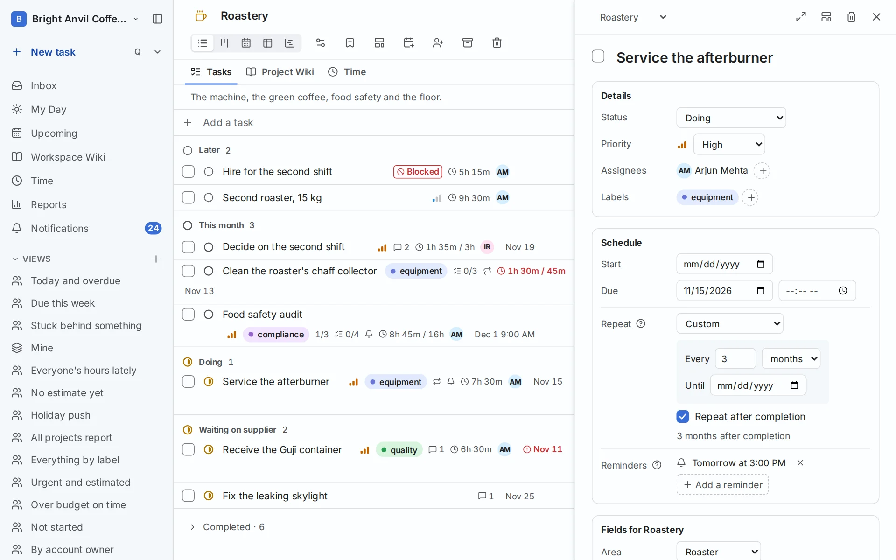

# Tasks

A task is one thing to do. This page covers making tasks, finishing them, and everything in the task panel. Dates, comments, dependencies and time have pages of their own.

## Making a task

There are several ways, and they all make the same kind of task.

- [Quick add](quick-add.md): press `q`, or choose New task in the sidebar, and type one line. On a phone, use the round add button.
- Add a task at the top of a list: type a title and press `Enter`.
- + Add a task at the foot of a board column. The task starts with that column's status or value.
- Add a subtask in a task's panel.
- From a [template](templates.md), with the button beside New task.
- From a spreadsheet, with a [CSV import](exports-and-imports.md#importing-a-csv-file).
- From an email, sent to one of your addresses for [email to task](email-to-task.md).
- As a copy of another: right-click a task and choose Duplicate. See [Duplicate](menus.md#duplicate).

A task made with no project goes to the workspace's [Inbox](daily-lists.md#inbox).

## Finishing a task

Tick the box on its row or in its panel, or press `x` on the row. On a phone, swipe the row to the right. The row holds for a second, and a message offers Undo.

Moving a task to a Done or Canceled status also completes it, and moving it back reopens it. Ticking the box moves the task to the project's first Done status.

Finished tasks collect under Completed at the foot of a project's list. To reopen one, untick it or press `x` on it. To have that section open by default, turn on Show completed tasks when a list opens in [Preferences](preferences.md).

Completing a [repeating task](schedule.md#completing-a-repeating-task) also makes the next one.

To complete several at once, [select them](selecting-tasks.md) and choose Complete in the bar.

## Keys on a task in a list

| Key | Does |
|---|---|
| `j` or Down | Next task |
| `k` or Up | Previous task |
| `Enter` | Open the task |
| `x` | Complete or reopen |
| `t` | Add to My Day, or take out |
| `1` `2` `3` `4` | Priority: urgent, high, medium, low |
| `0` | Priority: none |
| `Alt+Up`, `Alt+Down` | Move up or down |
| `Delete` or `Backspace` | Delete |
| `Space` | Select, to change several at once. See [Selecting tasks](selecting-tasks.md) |
| `Shift+F10` or the Menu key | Open the task's menu |

## The task's menu

Right-click a task, wherever it shows, for what you can do to it without opening it: complete, schedule, put in My Day, set the priority, status, labels and people, move it, start a timer, duplicate it, copy a link, save it as a template, or delete it. On a phone, hold your finger still on the task. See [Right-click menus](menus.md).

## Deleting a task

Choose the trash button in the task's panel, press `Delete` on its row, or choose Delete in its right-click menu. A message offers Undo, and the task then waits in the [trash](trash-and-archive.md) for 30 days.

## The task panel

Click a task to open it in a panel beside the list. Its address changes too, so you can copy the link to it.

- Drag the panel's edge to make it wider or narrower.
- The button at the top expands it to fill the page, and takes it back.
- `Escape` closes it, after closing any menu or picker that is open inside it.
- On a phone it opens as a sheet over the page. Pull it down by its top bar, or tap Close.

Across the top of the panel are the project, and buttons to expand, save as a [template](templates.md), delete and close. Changing the project moves the task, with its subtasks, to that project or back to the Inbox. Each moved task takes a status of the same kind in its new project.

A subtask shows its parent at the top instead of a project. Choose it to go up to the parent.

Click the title to change it. A title is one line: lines pasted into it are joined with spaces.

Changes save as you make them. There is no Save button.

### The two layouts

The panel can show its sections two ways. Choose in Settings, Preferences, under Task panel. Your choice follows you to every device.

Labeled boxes is the default. Everything shows at once, grouped under clear names.

Summary lines puts Status, Priority, Assignees and Labels on top, then gives every other section one line that says what is inside, such as `2 of 5 done` or `Due Nov 14 · Weekly on Friday`. Select a line to open it in place. Each device remembers which lines you left open. To begin with, Schedule and Notes are open.

### What each section holds

| Section | Holds |
|---|---|
| Details | Status, priority, assignees and labels. A task in the Inbox has no status |
| Schedule | Start and due dates, the repeat and your reminders. See [Dates, repeats and reminders](schedule.md) |
| Fields | The custom fields of its project and workspace, when there are any |
| Notes | Formatted text. See [Writing in notes and pages](writing.md) |
| Subtasks | Smaller tasks under this one |
| Checklist | Small steps with a tick box |
| Dependencies | What it waits for and what waits for it. See [Dependencies](dependencies.md) |
| Time | Its estimate, time logged and the timer. See [Time tracking](time-tracking.md) |
| Linked from | Pages and notes that link here, when there are any |
| Files | Attachments |
| Comments | See [Comments](comments.md) |
| History | What has changed on it |

A question mark after a name opens the help for that part. Rest the pointer on it to see what it explains.

## Subtasks

Type in Add a subtask and press `Enter`. A subtask is a full task with its own panel, dates, people and estimate. It always stays in its parent's project.

Subtasks go one level deep: a subtask has no Subtasks section of its own.

## Checklists

Type in Add an item and press `Enter`. Tick items off, edit them in place, or remove them with the X at the end of the line.

A checklist is part of its task. Use one for steps that need no date or person of their own. Rows and cards can show the count.

Checklists you write inside the notes are separate. Their boxes tick too, but only the Checklist section is counted on rows and cards.

## Priority

A task's priority is None, Low, Medium, High or Urgent. Set it in the panel, with the number keys on a row, with the [command palette](search-and-palette.md), or with `!high` in quick add.

## Labels

Labels belong to the whole workspace, so one label can mark tasks in any project.

In the panel, choose the plus beside Labels and tick the ones you want. Type in New label there to make one and put it on the task. Settings, Labels and fields renames them, changes their colors and deletes them. Deleting a label shows Undo.

## Assignees

In the panel, choose the plus beside Assignees and tick people. A task can have several.

The list shows who can reach the task: the workspace's members, and the guests its project is shared with. To give a task to another guest, first share the project with them in the [Share dialog](people-and-roles.md#sharing-a-project-with-a-guest). Mila will not assign a task to someone who cannot reach it. Someone given the task before they lost access stays in the list, so you can take them off.

The `@` list in [comments](comments.md#mentioning-someone) is narrower: it shows only people who can reach the task.

## Custom fields

A custom field adds your own detail to tasks, such as a cost or a client. Make them in Settings, Labels and fields. Each has a name, a type, and where it applies: every project or one.

| Type | Holds |
|---|---|
| Text | Words |
| Number | A number, for sums and comparisons |
| Date | A day |
| Select | One choice from a list |
| Multi-select | Several choices from a list |
| Checkbox | Yes or no |
| Link | A web address, with a button that opens it |
| Person | Someone in the workspace |

A field's type is fixed once it is made. You can rename a field, and for a select or multi-select you can add, rename, recolor or remove its choices. Deleting a field shows Undo.

Fill fields in the task's panel, or in the cells of a [table](layouts.md#table). Saved views can sort, group and [filter](filters.md#custom-fields) by them, with limits noted on those pages. A repeating task's next copy keeps its field values.

## Files

Choose Add a file, and pick one file. A file can be up to 25 MB, and adding one needs a connection.

Images in PNG, JPEG, GIF, WebP or SVG open in the browser. Other files download. The X beside a file removes it.

An image in the notes is a file attached to the task. See [Images](writing.md#images).

## History

History lists who changed what, newest first. In the labeled boxes layout, choose Show history at the end of the panel. In summary lines, it is the last line.

Every change shows, including time logged. Reordering alone does not. History needs a connection.

Guests see people's names in history too. Another guest they share no project with shows as "Someone".

## Next

- [Quick add](quick-add.md)
- [Dates, repeats and reminders](schedule.md)
- [Comments](comments.md)
- [Selecting tasks](selecting-tasks.md)
