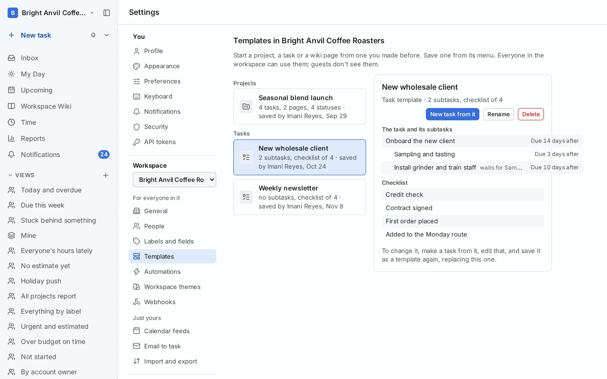

# Templates

A template is a copy of a project, a task or a wiki page to start new ones from. Templates belong to the workspace, and every member can use them. Guests do not see them.

## Saving a template

Open a project, or a task's panel, and choose Save as a template. Or right-click the project or the task and choose Save as a template in its [menu](menus.md). Name it, and choose whether it is a new template or replaces one you saved before.

A project template keeps:

- the project's statuses, fields, saved views, wiki pages, description, icon and color
- its open tasks, with their subtasks, checklists, notes, priorities, labels, field values, repeats and dependencies

A task template keeps the task and its open subtasks the same way.

Comments, files, history and finished tasks stay behind. Assignees stay behind too, unless you choose Keep assignees. Someone who has left the workspace by the time the template is used is left off, and Mila says so.

A template is a copy taken when you save it. Changing the project or task afterward does not change the template.

## A project from a template

On the Projects page, choose From a template beside the new project's name, or search the [command palette](search-and-palette.md) for "from a template". Pick the template, name the project and choose its start date.

The task with the earliest date lands on the start date, and every other date moves with it.

The new project's saved views are yours alone at first. [Share them](saved-views.md#sharing-a-view) as you would any view. Labels the template uses that the workspace no longer has are made again.

## A task from a template

The button beside New task in the sidebar lists the task templates, and the palette finds them too.

The task is made in the project you are looking at, or in the Inbox. It is due as many days after today as the template's task was due after it was saved. The message that follows opens the task, or takes it back.

## A wiki page from a template

To save a page, choose Save as a template in its menu, or right-click it in the tree of pages. A page template holds the page's title and text and, if you keep them, its subpages. Comments, history and files stay behind, and images with them.

A new, empty page lists the workspace's page templates under its text until you start typing. You can also use the button beside New page in the list of pages, or the [command palette](search-and-palette.md). A template only ever fills an empty page. It works in any wiki in the workspace, and links between its pages lead to the new copies.

Write `{{today}}` in a page's title or text, and using the template puts in the date it is used on, the way you show dates. See [The wiki](wiki.md).

## Managing templates

Settings, Templates lists the workspace's templates and shows what each one holds, with its dates counted in days from its first. Rename a template there, start something from it (New page from it, for a page template), or delete it. A deleted template stays in the [trash](trash-and-archive.md) for 30 days.

To change a template, start a project, a task or a page from it, change that, and save it as a template again, replacing the old one.

A workspace keeps up to 200 templates, each with up to 500 tasks, and a page template holds up to 100 pages. Templates go into the workspace's JSON export and come back with an import.

## Next

- [Exports and imports](exports-and-imports.md)
