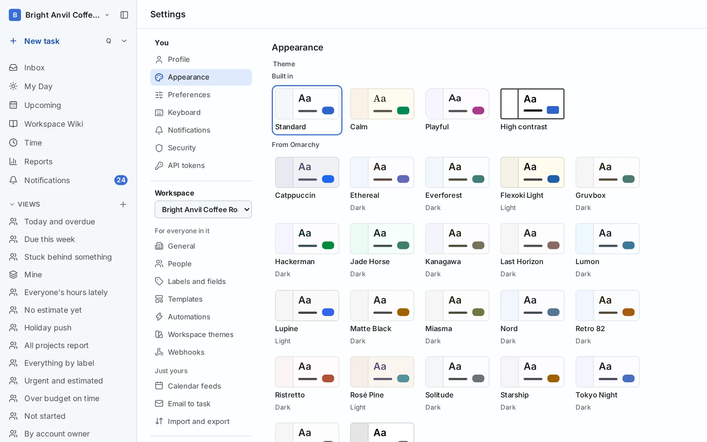

# Themes

A theme sets how Mila looks. There are four built-in themes and 22 made from Omarchy's, you can make up to 20 of your own, and a workspace can offer up to 10 to everyone in it.

## Choosing a theme

Pick a theme in Settings, Appearance: the built-in ones (Standard, Calm, Playful and High contrast), then those from Omarchy, then the themes your workspace offers, then your own. The [command palette](search-and-palette.md) has a Theme command for each of them too.

Your density and font size still apply on top of any theme.

Theme: Standard in the palette always takes you back to a built-in theme, whatever you are wearing.

Your theme is yours everywhere, so switching workspaces never changes it.

## Themes from Omarchy

[Omarchy](https://omarchy.org) is a Linux desktop with its own themes. Mila has each of them as a theme: Catppuccin, Ethereal, Everforest, Flexoki Light, Gruvbox, Hackerman, Jade Horse, Kanagawa, Last Horizon, Lumon, Lupine, Matte Black, Miasma, Nord, Retro 82, Ristretto, Rosé Pine, Solitude, Starship, Tokyo Night, Vantablack and White. Each uses the theme's colors for pages, text and the accent. Where a color would be hard to read, it is a little lighter or darker in Mila, keeping its hue, so every one reads at AA. Label, status and priority colors take the theme's own where it has that hue, so urgent stays red.

Most Omarchy themes come in dark or light only, which the theme's card says. Picking one switches Scheme to it; the other scheme still works, with a version made from the same hues. Catppuccin has both: Mocha in dark and Latte in light.

To change one, make a copy: in Settings, Appearance, start a new theme from it. The copy is yours to edit.

## Making a theme

In Settings, Appearance, choose what to start from (a built-in theme, a copy of one from Omarchy, or a copy of one of yours) and select New theme.

Customize this theme in the palette does the same for the theme you are wearing, or opens it if it is one of yours. A workspace's theme becomes a copy of your own.

Your theme starts from a built-in one and changes only what you choose. Your themes follow you to every device you sign in on.

Themes made from High contrast aim for AAA, the stricter contrast goal. One that misses it says Below AAA.

## Editing a theme

The editor lists the theme's parts on the left: surfaces, text, borders, the accent, status and priority, label colors, charts, the sidebar, lists, cards, buttons, fields, menus, the focus ring, shadows, corners, type, pages, spacing and motion.

The preview in the middle shows the part you are editing in your theme. Whole app shows all of it, and Light, Dark or Side by side chooses the scheme. On a smaller screen the preview sits on top, and Hide preview folds it away.

The part's settings are on the right, a row each with its color or value and, for a color, its contrast. Choose a row to open its editor in place, with what it is used for and Reset. Done or `Escape` closes it. The accent, type, spacing and motion start with settings that change the whole part at once: the accent's hue, all text sizes, all spacing, and the speed of every animation.

To find a setting, click anything in the preview, which opens what draws it, or type in Find a setting, which looks through every part. Changed only shows just what your theme sets.

Pages sets how task notes and wiki pages look: their font, size and line height, the highlight colors, and the colors of each heading level, links, list bullets and numbers, code, quotes, tables (their lines, header row and stripes) and dividers. Each starts as the color it has always been. The preview's sample of notes shows them all.

Colors and shadows can differ between light and dark. Corners, type, spacing and motion are the same in both. Choose Light or Dark under Editing to change that scheme. A setting marked Both schemes is the same in each.

A color opens with Same as, which makes it follow another setting, then lightness, chroma and hue on tracks of the color's own range, a hex field and your system's color picker.

The accent can be worked out from a hue, which keeps it readable on every surface, or set by hand for light and dark.

Changes save as you make them. If you are wearing the theme, the app follows each change.

### Undo and resets

Undo and Redo are at the top of the editor, or press `Ctrl+Z` and `Ctrl+Shift+Z`, when you are not typing in a field. A slider moved and let go is one change.

Reset puts one setting back as its built-in theme has it, in the scheme you are editing. The reset beside a part's name puts back the whole part, in light and dark. More has Revert to when I opened it, and Reset all.

### Contrast and Fix

Each color shows its contrast against what it is read on, such as `4.8:1 on Page`. One that falls short is marked on its row, says what it needs when open, and Fix moves it as little as it takes to pass. The contrast button at the top says how the theme reads; it opens every shortfall in both schemes, and the contrast goal. Choose a shortfall to go to its setting.

Contrast is a warning, with one exception: a theme whose text or focus ring would be harder than 3:1 to see on the page cannot be used. If you edit the theme you are wearing that far, the app keeps its last readable version until you fix it.

## Sharing a theme

In Settings, Appearance, More beside a theme exports it as a file, or copies it as text to paste in a message.

To bring one in, choose the file or paste the text under Import a theme. Mila shows the theme first: its name, what it is based on, how it looks, its contrast, and anything it left out because this Mila cannot use it. Only Add theme keeps it.

Deleting a theme shows Undo, which brings it back as it was, in use if it was.

## Workspace themes

A shared workspace can offer themes to everyone in it, guests too. Nobody is switched to one. They show in the theme picker under the workspace's name, and on a page of their own, Settings, Workspace themes, for the workspace picked under Workspace in Settings.

Use one, or Duplicate it to make a copy of your own to change. A copy no longer follows the workspace.

### Publishing

Owners and admins publish one of their own themes under a name of its own in the workspace, up to 10. A theme whose text or focus ring would be under 3:1 on the page cannot be published.

When they change their theme, Update from it in More changes the workspace's copy for everyone using it. More also has Rename and Unpublish.

### Suggesting

An admin can suggest one theme at a time. Everyone else is asked once, the next time they open the workspace, whether to use it. Use it and No thanks are both remembered on every device, and the same theme is never asked about again.

### When a workspace theme goes away

If the workspace stops offering the theme you use, or you leave it, you keep seeing the theme until you choose: Save a copy to my themes keeps it as one of yours, unchanged, or switch back to the built-in theme it was made from.

## Next

- [Templates](templates.md)
- [Preferences](preferences.md)
