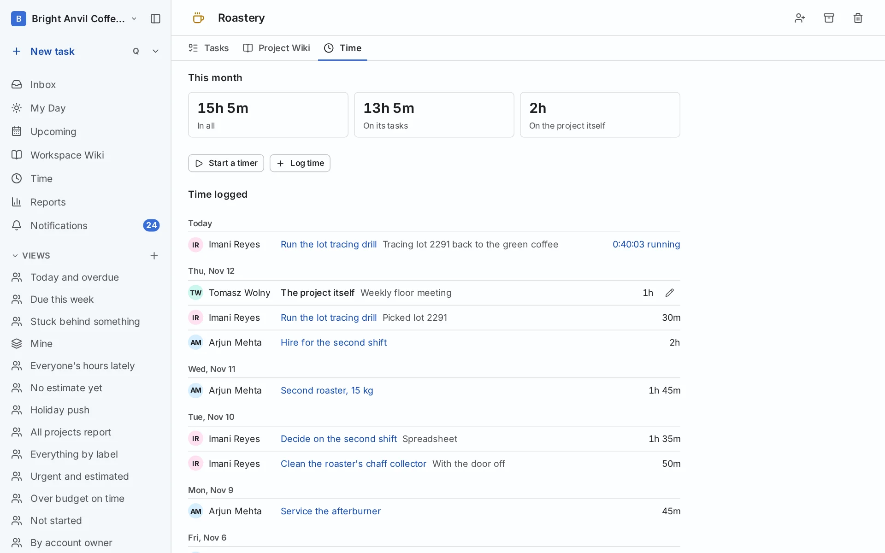
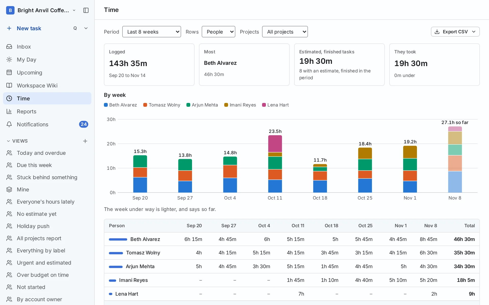

# Time tracking

Tasks can carry an estimate and the time spent on them. You can log time by hand or run a timer, and the Time page adds it up.

## Estimates

Type an estimate in the Time section of the task's panel. `1h 30m`, `90m`, `1.5h` and `1:30` all mean an hour and a half, and a number on its own counts hours. Clear the box to take the estimate away. An estimate can be up to 999 hours.

A subtask has an estimate of its own. A parent shows its own figures, and below them its subtasks' added in, so nothing is counted twice when a view adds up a column.

## Logging time

Choose Log time in the task's panel. Write how long, pick the day, and add a note if you like. The day is today unless you change it, and it can never be a day still to come.

One entry holds up to 24 hours. Log the rest as another.

The panel shows the time logged, then what is left of the estimate, or how far past it the task has gone, in red. Below are the entries, newest first. Change or delete your own with the pencil beside each. Admins and owners can change anyone's. Every change shows in the task's history.

Everyone who sees a task sees the time logged on it. Guests can log time on the tasks they see.

## The timer

Choose Start a timer in the task's panel or in the task's [right-click menu](menus.md), or search the [command palette](search-and-palette.md) for "timer" with a task focused or open. The menu has Stop the timer while it runs on that task.

The timer runs at the foot of the sidebar, or above the tabs on a phone, on every page and every device you use. The task's row shows it ticking. Stop it there or in the panel, and the time is logged on the day it started.

You have one timer at a time. Starting another stops the one running and logs it. A timer stopped before a minute logs nothing.

A timer left running for 10 hours asks what to do the next time you open Mila: stop it when you last did something in Mila, stop it at a time you choose, or keep it going.

## Time on a project itself

Some work belongs to a project but to none of its tasks: a meeting, planning, travel. Log it on the project's Time tab, beside Tasks and Project Wiki. Log time and Start a timer there go to the project itself, as they do on a task, and the timer is your one timer, as a task's is.

Log time on the [Time page](#the-time-page) does the same for any project: choose the project, then the time, the day and a note. While the page shows one project, the form starts on it.

The Time tab shows this month's time in all, on the project's tasks and on the project itself, and below it every entry of both kinds, newest first. Change or delete your own time on the project with the pencil beside it; admins can change anyone's. An entry on a task opens its task.

While you are on a project's page, the [command palette](search-and-palette.md) has Log time to the project and Start a timer for the project. The project's [right-click menu](menus.md) has Log time and Start a timer too.

Everyone who sees the project sees its time, and guests can log time to the projects they see.

## Time in views

- Rows and board cards show time logged against the estimate, such as `3h 20m / 6h`, in red once past it. Board columns add them up.
- [Tables](layouts.md#table) have Estimate, Time logged and Remaining columns, which sort and sum.
- On a [timeline](layouts.md#timeline), a bar fills as time is logged against its estimate, and turns red past it.

Choose which of these show in a saved view's [Display panel](saved-views.md#sort-group-and-show), and sort by any of them there. Inbox, My Day and Upcoming have the same Display panel. See [Other ways to see them](daily-lists.md#other-ways-to-see-them).

A view's [filter](filters.md) can ask for tasks with an estimate or none, tasks over their estimate, tasks with time logged in the last seven days, or time you logged. Every time condition you choose must hold.

## The Time page

Press `g` then `l`, or choose Time in the sidebar.

It adds up what was logged in the Period you choose: this week, last week, this month, last month, the last 8 or 12 weeks, this quarter, last quarter, or between two days. Show a row for each person, project or label, for every project or one. A week has a column for each day. Anything longer has one for each week, starting on the day set in your [preferences](preferences.md).

With a column for each week, By week charts the hours logged each week, stacked by the rows: the five with the most each in a color of their own, and the rest together as Others, with each week's total on top. The week under way is lighter, and its total says "so far". Point at a week, or tap it, to see its parts; from the keyboard, move to the chart and the arrow keys step through the weeks.

A task with two labels counts under both, so the label rows can add up to more than the total. The total counts each piece of time once. Time on a project itself counts with its project and its person, and under Not on a task when the rows are labels. Estimates against what they took leaves it out, since it is on no task.

Estimates against what they took sets each project's estimates for the tasks finished in the period beside all the time logged on them.

Export CSV saves This table, as the page shows it (a line for each row, a column for each day or week, and the totals, in hours), or Every entry, one line each.

Guests see only their own time on this page.

## Elsewhere

Time logged goes into the workspace's JSON and CSV [exports](exports-and-imports.md) and comes back with an import; time on a project itself has an empty task in the CSV. The [daily digest](notifications.md#the-daily-digest) says what you logged yesterday, on tasks and on projects, and which of your tasks are past their estimate. The [weekly report](notifications.md#the-weekly-report) counts both kinds too.

## Next

- [Inbox, My Day and Upcoming](daily-lists.md)
