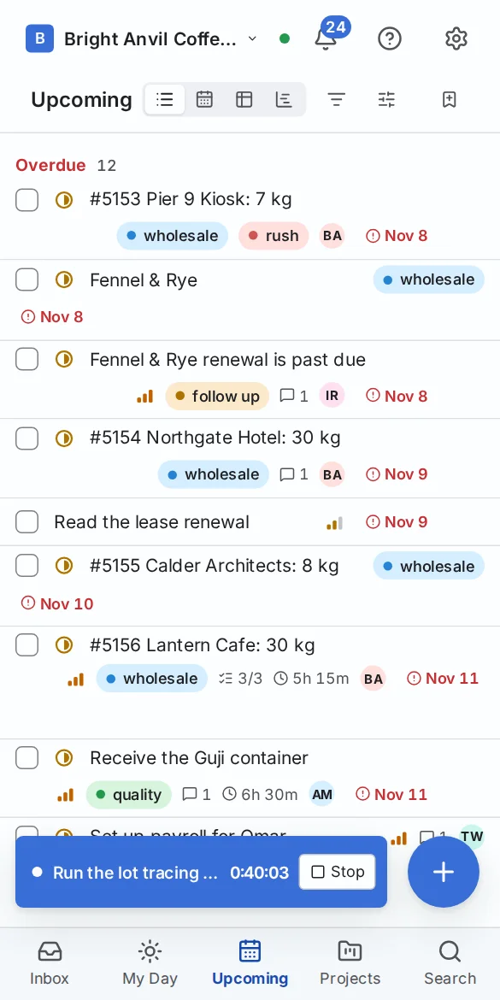

# What Mila is

Mila is a project manager that you use in a browser, on a computer or a phone, or in its desktop app for Windows and Linux. It keeps your work on each device as well as on its server, so it keeps working without a connection and changes appear at once.

Someone runs a Mila server, and you reach it at its own address. You might run it yourself, or someone might invite you to theirs. Accounts come by invitation only.

The desktop app can also keep your work on your computer alone, with no server and no account. See [The desktop app](desktop-app.md).

## The ideas it is built on

### Workspaces

A workspace holds everything: projects, tasks, wikis, labels, fields and the people who share them. You can belong to several, and the menu at the top of the sidebar switches between them. On a phone it sits in a bar above the page.

Every account starts with a workspace called Personal. It is yours alone. You can rename it, but you cannot delete it or invite anyone to it.

To work with other people, choose New workspace in that menu. You become the new workspace's owner, and you can invite people from Settings, People. Anyone with an account can make one.

### Projects

A project is a body of work with its own tasks, statuses and wiki. "Kitchen remodel" could be a project, and so could "Q4 launch". See [Projects](projects.md).

Each project has statuses that its tasks move through. A new project starts with Backlog, To do, In progress, Done and Canceled, and you can change them.

### Tasks

A task is one thing to do. It has a title and can also hold notes, dates, a repeat, reminders, subtasks, a checklist, labels, people, custom fields, files and comments. See [Tasks](tasks.md).

A task does not need a project. A task with no project sits in the workspace's Inbox until you give it one. In a shared workspace, every member sees the same Inbox.

### Views

The same tasks can be shown in different ways. A project can be a list, a board, a calendar, a table or a timeline, and you switch at any time. See [Layouts](layouts.md).

Inbox, My Day and Upcoming can each be a list, a board, a calendar, a table or a timeline too. See [Inbox, My Day and Upcoming](daily-lists.md).

A saved view keeps a layout and a filter under a name in the sidebar, such as "Everything due this week assigned to me". It can draw from one project or all of them. See [Saved views](saved-views.md).

### Wikis

A wiki holds what is not a task: how things are done, decisions, plans. The workspace has one, and so does each project. People can comment on the words in a page. See [The wiki](wiki.md).

### Members and guests

Everyone in a workspace has one of four roles.

| Role | In short |
|---|---|
| Owner | Everything, including deleting the workspace |
| Admin | Runs the workspace: invites people, changes roles, shares projects with guests |
| Member | Sees and edits all the workspace's work |
| Guest | Sees only the projects shared with them, and works on tasks there |

[People and roles](people-and-roles.md) has the full list. [If you are a guest](guests.md) is written for guests.

### Labels and custom fields

Labels mark tasks across a whole workspace. Custom fields add your own details to tasks, such as a cost or a client, for every project or for one. Both are managed in Settings, Labels and fields. See [Tasks](tasks.md#labels).

### Routine work

- [Automations](automations.md) are rules that change tasks when something happens to them, such as assigning a task when it moves to In progress.
- [Email to task](email-to-task.md) gives you addresses that turn the mail sent to them into tasks.
- [Selecting several tasks](selecting-tasks.md) lets you change them all at once.
- [Right-click menus](menus.md) offer what you can do to a task, view, project or page without opening it.

### Your own lists

Three things in Mila belong to you alone, even in a shared workspace: the tasks you pick for My Day, your reminders, and any saved view you have not shared.

## Finding your way around

The sidebar holds Inbox, My Day, Upcoming, Workspace Wiki and Time, the bell for notifications, your saved views and your projects. You can hide or reorder these in [Preferences](preferences.md). At its foot are the sync dot, your name (which opens Settings), Help, Trash and Sign out.

On a phone, the tabs along the bottom are Inbox, My Day, Upcoming, Projects and Search, with a round button for adding a task.

To go anywhere by typing, use the [command palette](search-and-palette.md): press `Ctrl+K` and type.

## Next

- [Signing in](signing-in.md)
- [Your first project](first-project.md)
