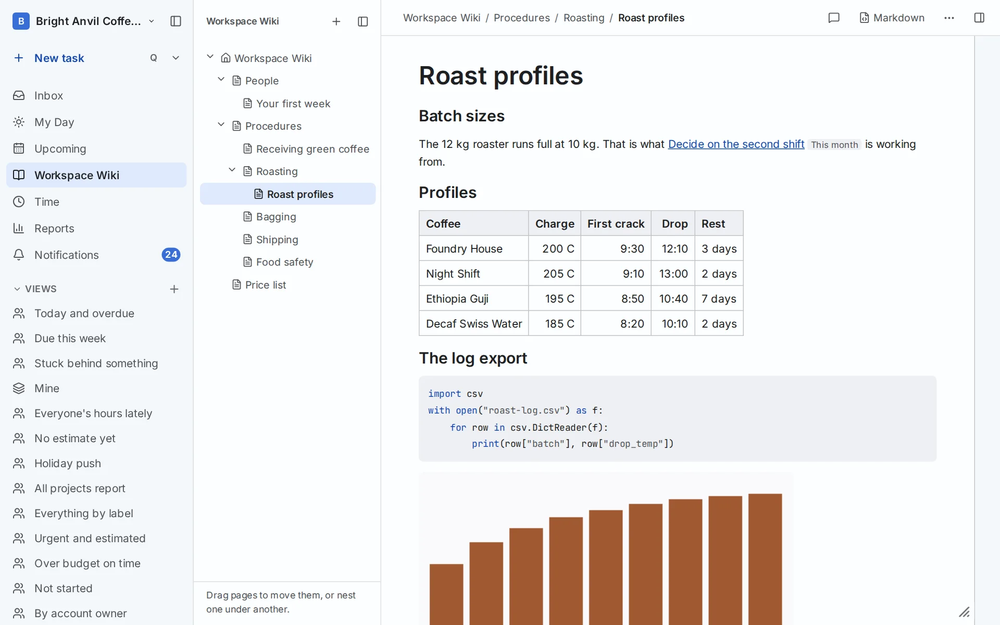

# The wiki

A wiki is for what you want to keep that is not a task: how things are done, decisions, lists and plans.

## The workspace's wiki and each project's

The workspace has one wiki, under Workspace Wiki in the sidebar, or `g` then `w`. Each project has its own, on the project's Project Wiki tab beside its Tasks tab. A project opens on whichever tab you had open last.

Every wiki starts with a main page, named after its workspace or project.

Guests see the wikis of the projects shared with them, and never the workspace's. Those they can read and edit.

## Pages and subpages

The tree beside the page shows every page in the wiki. To add a page, use the plus at the top of the tree, or New page under this one in the page's menu. Either adds a page under the one you are on. Type its title and press `Enter` to start writing.

The path above the title shows where the page sits.

The page's menu is More, the button above the page. It holds New page under this one, Copy link, Save as a template, Font and size, History and Delete.

Right-click a page in the tree for its own menu: Open, Open in a new tab, New page under it, Rename, Copy link, History, Save as a template and Delete. A main page has no Rename or Delete. See [Right-click menus](menus.md).

To move a page, drag it in the tree before, after or into another page. With the keyboard, focus it in the tree:

| Key | Moves it |
|---|---|
| `Alt+Up`, `Alt+Down` | Among its siblings |
| `Alt+Right` | Under the page above it |
| `Alt+Left` | Out a level |

## Giving a page more room

The tree folds away with its button, or `Ctrl+.`, and comes back the same way. On a phone, Show pages opens the tree as a sheet.

To make a page wider or narrower, drag the grip in its bottom right corner, or anywhere along its right edge. The edge of the tree drags too. You can also focus an edge and use the arrow keys: `Shift` takes bigger steps, and `Home` and `End` go narrowest and widest. Double-click the page's grip, or press `Enter` on it, to put the page back to where it started.

Each device remembers its own widths.

## Beside the page

When there is room to the right of the page, a panel there has three tabs:

- Contents lists the page's headings, so you can jump to one.
- Pages shows the wiki's pages, the same as the tree.
- Comments holds the page's comments. See [Comments on a page](#comments-on-a-page).

The button at the top of the panel hides it, and the page then takes all the room there is unless you drag it narrower. Show contents and pages, at the top right of the page, brings the panel back.

## Writing

Pages are written in the same editor as a task's notes, and saved as Markdown. Use the [toolbar](writing.md#the-toolbar-in-a-page) at the top of the page, select text for the formatting bar, or type `/` at the start of a line for lists, checklists, tables, columns, foldable sections, a saved view, boxes and images. [Writing in notes and pages](writing.md) has the details, and [A page's font and size](writing.md#a-pages-font-and-size) shows how to give one page its own look.

Several people can write in a page at once, and everything each of them types stays. Their pictures and names show above the page while they have it open, and their cursors show in it as they type. See [Offline and sync](offline-and-sync.md#when-two-people-edit).

The Markdown button above a page shows it as Markdown, to read or edit. Press it again to go back.

## Comments on a page

Select some words in a page and choose Comment in the formatting bar, or press `Ctrl+Alt+M`. Write your comment and choose Comment, or press `Ctrl+Enter`. `Escape` or Cancel drops it.

Your comment goes in the Comments tab beside the page, and the words are highlighted. Selecting a highlight, or moving the cursor into one, picks its thread. Anyone who can read the page can comment, guests included.

The comments button above the page opens the tab, and shows how many threads are open. When there is no room beside the page, the comments open over the page's edge, and on a phone as a sheet.

Each thread can take replies. Mentions, `/task` and `/wiki` work as they do in a task's comments, and the people you can mention are those who can reach the page. See [Comments](comments.md). You can edit and delete your own comments. Owners and admins can also delete other people's, with Undo.

A highlight follows its words as people edit around them. If the words are deleted, the thread stays and shows what it was on. Highlights are never part of the page's text, so they stay out of its Markdown and its history.

Resolve a thread when it is settled: its highlight goes and it moves to Resolved, under the open threads. Anyone can choose Reopen there to bring it back with its highlight.

People you mention get a Mentions notification. Everyone already in the thread is told too, under Comments on pages in [Settings, Notifications](notifications.md).

## Page templates

A page template is a copy of a page to start new ones from. To save one, choose Save as a template in the page's menu. It holds the page's title and text and, if you keep them, its subpages. Comments, history and files stay behind, and images with them.

A new, empty page lists the workspace's page templates under Start from a template until you start typing. You can also use New page from a template, the button beside New page at the top of the tree, or the [command palette](search-and-palette.md). A template only ever fills an empty page. It works in any wiki in the workspace, and links between its pages lead to the new copies.

A page fills from a template only when you made it from that template yourself, in that browser tab. A link someone sends you never fills a page.

Write `{{today}}` in a page's title or text, and using the template puts in the date it is used on, the way you show dates.

Templates belong to the workspace, and guests do not see them. See [Templates](templates.md).

## History

History, in a page's menu, lists a version of the page for each time someone wrote in it. The same person's writing counts as one version until they stop for five minutes or leave the page. Each version shows who wrote it and when, with the words it added underlined and those it removed struck through.

Restore this version puts a page back as it was then. The page as it was before stays in the history too, so a restore can be undone, or restored over in turn.

A page keeps its newest 500 versions. On a very long page it keeps fewer, the oldest going first.

History needs a connection.

## Deleting pages

Delete is in the page's menu. A deleted page takes its subpages with it, and a message offers Undo. Deleted pages wait in the [trash](trash-and-archive.md) for 30 days, where Restore brings a page back with its subpages.

A main page cannot be deleted. It goes with its project or workspace.

## Finding a page

The [command palette](search-and-palette.md) finds pages by their titles and by what they say, beside tasks and projects.

Copy link, in a page's menu, gives an address that opens the page for anyone who can see it.

## Linking

Type `[[` in a page or in a task's notes to link to a page or task. In a comment, use [`/wiki`](comments.md#referring-to-a-task-or-page). A page ends with what links to it. See [Links to pages and tasks](writing.md#links-to-pages-and-tasks).

## Exports

Exports, in Settings, Import and export, hold the wikis you can see. A JSON export keeps every page with its history and files, and an import of it brings them back with links and images pointing at what came in with them. A Markdown export writes a Wiki folder for each wiki, with a file per page and a folder for each page's subpages. Both hold a page's comments: the Markdown export puts them under Comments at the end of the page's file. See [Exports and imports](exports-and-imports.md).

## Next

- [Writing in notes and pages](writing.md)
- [People and roles](people-and-roles.md)
